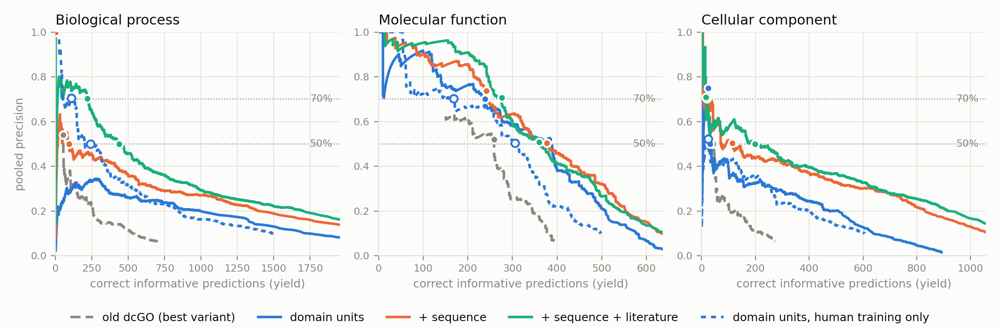

# Projecting protein function into one ranked list: domain-centric annotation with shrunken frequency estimates, plus sequence and literature neighbours

Dan Bolser

*Draft, 6 November 2026. Every table (Tables 1–14 in the text, S1–S4 at the end) is generated from the result files by
`paper/make_projection_tables.py`, and Figure 1 by
`paper/make_projection_figures.py`; no number in a table was typed by hand.*

## Abstract

Domain-centric annotation (dcGO) links protein domains to Gene Ontology
(GO) terms with enrichment tests and transfers the significant links to
proteins that carry the domains. Its scores answer "is this link real?"
rather than "how often does it hold?", and they are rescaled within each
protein, so the same score does not mean the same thing on different
proteins, and a threshold on a list pooled across proteins has no fixed
meaning. We keep dcGO's core idea, that reusable
domains carry function, and change what is projected: a shrunken estimate
of the fraction of proteins carrying a domain that have a term. We add
three sources of evidence: experimental annotations of all species, nearest
neighbours in a protein language-model embedding (ProtT5), and nearest
neighbours in an embedding of each gene's literature published before the
training date. The pre-registered criterion is the knowledge yield KY50:
the number of correct informative predictions a single ranked list
delivers while at least half of what it delivers is correct. Design choices
were made on a 2018 → 2021 development split, and the 2021 → 2026 test
split was run once. On the test split the full method raised KY50 from 54
to 438 for biological process (8.1×; 95% CI 2.3–20.6 with the baseline
re-chosen in each resample, unbounded above with the pre-registered fixed
baseline; a gain of 384 correct predictions, 143–570) and from 259 to 360
for molecular function (1.4×; 1.1–2.0). Against the best old variant on each measure, pooled
average precision rose 4.5-, 2.0- and 6.8-fold for process, function and
component. The pre-registered target, a tenfold KY50 gain in both process
and function, was not met; for function no method could have met it on
this test set. Domain units alone improved ranking quality but delivered
almost nothing at 50% precision in biological process; trained on human
annotations alone they delivered 241 (a post-hoc run), so adding the
all-species background caused the collapse there, though by point
estimate it helped molecular function. About
half of the later evidence cites papers that existed at the training date,
so the literature channel may partly forecast curation. Separately, we show
that most apparent "additions" to the curated InterPro2GO mapping on the
test interval (63%) are renamed GO identifiers, which changes conclusions
drawn from that reference.

## 1. Introduction

Most proteins in most species have never been studied directly. Gene
Ontology (GO; Gene Ontology Consortium 2023) annotation of the rest relies
on projection: carrying what is known about studied proteins over to
unstudied proteins that share something with them. Protein domains are a
natural carrier. They are compact, reusable units that recur across
thousands of proteins and all of life, and many do the same job wherever
they occur. The dcGO method (Fang and Gough 2013a, 2013b) turned this into
statistics. For every domain and every GO term it asks, with Fisher's exact
test, whether proteins carrying the domain have the term more often than
chance; it keeps the links that survive a false-discovery-rate correction,
and predicts a protein's terms from its domains. It also tests combinations
of two or three domains ("supra-domains"), in case a function appears only
when domains occur together.

Two features of this design work against projection. First, a p-value
measures how sure we are that a link exists, not how often it holds. Take
15,000 annotated proteins, 300 of which (2%) have some term. A domain
carried by 1,000 of them, 100 with the term, gives a one-sided Fisher
p-value of about 3.5 × 10⁻⁴⁴, yet only one carrier in ten has the term. A
domain carried by four proteins, all with the term, gives about 1.6 × 10⁻⁷, a
value easily lost when hundreds of millions of domain–term pairs are
corrected for multiple testing, although every carrier seen so far has the
term. Four carriers are thin evidence, so the right estimate for the second
domain is high but uncertain (the estimator of Section 4.2 gives 0.89,
against 0.10 for the first). Second, dcGO's protein-level score, the
p-score, is rescaled within each protein so that its best term scores 1 and
its worst 0. A score of 1 on one protein and a score of 1 on another
therefore carry no shared meaning.

Both features matter because of how predictions are used. A curator, or a
downstream analysis, works down one list of (protein, term) predictions and
stops when the list stops being trustworthy. What counts is how much
correct knowledge the list delivers before its error rate becomes
unacceptable. In earlier evaluations within this project, dcGO beat a
term-frequency baseline on the protein-centric F_max for informative terms
but lost to it on average precision, and about half of the evaluated
proteins received no prediction at all, because none of their domains had
a significant link.

This paper describes a replacement for the projected quantity, three new
sources of evidence, and a measurement protocol built around one pooled
list at a fixed precision. Its contributions are:

1. **An estimator for projection.** For every unit (here, an InterPro entry)
   and GO term we estimate the fraction of proteins carrying the unit that
   have the term, among proteins annotated in that GO aspect, shrunk
   towards the term's base rate, and score a protein by its best unit.
   These scores are estimated frequencies on one scale across proteins;
   the full method averages them with the neighbour channels' scores, on
   the same 0–1 scale, which is not itself a probability. We test
   whether a cutoff keeps its precision over time; we do not claim the
   scores are calibrated probabilities, and Section 5.3 shows where they
   are not.
2. **New evidence.** Experimental annotations of all species at the training
   date; nearest neighbours in UniProt's ProtT5 per-protein embeddings; and
   nearest neighbours in an embedding of each gene's literature from before
   the training date.
3. **A measure and a protocol.** Knowledge yield at a fixed pooled precision
   (KY50), pre-registered with its baseline and decision rule before any
   result existed; development on an earlier split; a review before the
   test; one run of the frozen method on the test split.
4. **Findings, including negative ones.** The gains are large for biological
   process and cellular component and modest for molecular function; the
   pre-registered tenfold target was not met; and, on the test interval, a
   widely used way of scoring against curated InterPro2GO additions mostly
   counts renamed GO identifiers.

## 2. Related work

dcGO is described by Fang and Gough (2013a, 2013b). This work starts from
dcGO-2.0, a reimplementation that, before this study, corrected three
departures from the original method: how associations are scored, how
scores are transferred to proteins, and how supra-domains are built.
Domains come from InterPro (Paysan-Lafosse et al. 2023) and human
annotations from the GOA project (Huntley et al. 2015). InterPro2GO is the
curated mapping from InterPro entries to GO terms (Burge et al. 2012).
PANTHER groups proteins into families and subfamilies (Thomas et al. 2022),
and the PAINT project annotates family members from their phylogeny
(Gaudet et al. 2011); GO records those annotations with the evidence code
IBA ("inferred from biological aspect of ancestor").

Protein function prediction is benchmarked by the CAFA challenges
(Radivojac et al. 2013; Jiang et al. 2016; Zhou et al. 2019), whose temporal
design we follow. Clark and Radivojac (2013) discuss information-theoretic
evaluation and how general terms inflate frequency-based baselines.
Combining predictors by learning to rank was introduced by GOLabeler (You
et al. 2018) and extended with literature features in NetGO 2.0 (Yao et al.
2021). Transfer through nearest neighbours in protein language-model
embeddings is goPredSim (Littmann et al. 2021); we use the ProtT5 model
(Elnaggar et al. 2022) through the per-protein embeddings UniProt
distributes (UniProt Consortium 2025). Gene mentions in PubMed come from
PubTator 3.0 (Wei et al. 2024). Schnoes et al. (2013) show that a few
high-throughput papers dominate experimental annotation, which motivates
one of our sensitivity analyses.

## 3. Data

### 3.1 Releases

| Input | Development split | Test split |
|---|---|---|
| Training annotations, human (t0) | GOA human release 181, generated 2018-06-18 | GOA human release 205, generated 2021-04-21 |
| Truth annotations, human (t1) | GOA human release 205 (2021-04-21) | GOA human, generated 2026-06-17 |
| Domain architectures at t0 | InterPro 69.0 (2018-06-21) | InterPro 85.0 (2021-04-08) |
| Cohort domains at t1 | InterPro 85.0 | InterPro `protein2ipr`, downloaded 2026-07-07 |
| All-species background | GOA UniProt release 178 (2018-05-23), experimental evidence | GOA UniProt release 203 (2021-04-08), experimental evidence |
| Literature | papers published ≤ 2017 | papers published ≤ 2020 |
| Curated domain–GO reference | InterPro2GO 69.0 → 85.0 | InterPro2GO 85.0 → 2026-06-01 |
| GO ontology | `go-basic` release 2026-06-15 | same |
| Sequence embeddings | UniProt ProtT5 per-protein embeddings (human reference proteome and Swiss-Prot), current release | same |

Everything a method learns from — training annotations, the all-species
background, domain architectures and the papers behind the literature
vectors — is dated on or before its split's t0, with one exception of
days: InterPro 69.0 was released three days after the development split's
t0. Inputs dated at t1 (truth annotations and cohort domains) only define
the cohort and the truth. Five inputs are current rather than dated: the GO
ontology (one release for both splits, used by old and new methods alike);
the ProtT5 vectors, computed on current sequences; the PubTator 3.0 gene
tags and the gene-to-accession mapping used to collect each gene's papers;
and the weights of the two embedding models. Section 6 discusses what this
allows.

### 3.2 The benchmark cohort

We follow CAFA's temporal design with a per-aspect cohort. For each GO
aspect — biological process (BP), molecular function (MF) and cellular
component (CC) — the cohort is the human proteins that had **no** curated
annotation in that aspect at t0 but had gained an experimental one by t1,
and that have at least one InterPro domain in the cohort release. CAFA's
"no-knowledge" targets have no experimental annotation in any aspect; ours
need only lack knowledge in the aspect scored, and 76%, 66% and 71% of the
full BP, MF and CC cohorts (318, 441 and 466 proteins; 76%, 68% and 72% of
the IC ≥ 2 cohorts) had a curated annotation in another aspect (CAFA would
call these limited-knowledge targets). Section 5.4 reports the stricter
subset with no curated annotation in any aspect. It is not CAFA's
no-knowledge set: our "curated" codes include the computational-analysis
codes (ISS, ISO, IBA and others) and NAS, which CAFA does not count, so it
is stricter there; the high-throughput codes, which recent CAFA
rounds count as experimental, do not disqualify a protein here; and our
truth uses six experimental codes, without the TAS and IC that CAFA has
counted. Electronic annotations disqualify a protein in neither.

"Curated" means the evidence codes used for human training: the
experimental codes (EXP, IDA, IPI, IMP, IGI, IEP), the computational-analysis
codes (ISS, ISO, ISA, ISM, IGC, IBA, IBD, IKR, IRD, RCA), and TAS, NAS and
IC. It excludes IEA, ND and the high-throughput codes (HTP, HDA, HMP, HGI,
HEP). A protein's truth is its full set of t1 annotations with the six
experimental codes in the aspect, propagated up the GO graph, without the
aspect root. Predictions and truth are both restricted to informative terms:
those with information content IC ≥ 2 bits, that is, carried by at most a
quarter of annotated human proteins, with IC from propagated t0 training
annotations. Terms never seen at t0 have no IC and are dropped as well (62,
44 and 15 truth pairs on the test split). The floor removes near-universal
terms such as "protein binding", which otherwise dominate the scores (Clark
and Radivojac 2013); Section 5.4 reports results without it. Table 1 gives
the sizes.

**Table 1. Training sets and benchmark cohorts.** Training proteins are
those with at least one annotation in the aspect at t0, before and after
adding the all-species experimental background (Section 4.3). Cohort
proteins are those scored; at IC ≥ 2 a protein needs at least one
informative truth term.

<!-- BEGIN table:cohorts -->
| split | aspect | training proteins, human | + all-species background | cohort proteins | cohort proteins, IC ≥ 2 | truth pairs, IC ≥ 2 |
|---|---|---|---|---|---|---|
| development (2018 → 2021) | BP | 14,703 | 83,263 | 337 | 337 | 6,470 |
| development (2018 → 2021) | MF | 15,379 | 69,157 | 1,296 | 206 | 1,112 |
| development (2018 → 2021) | CC | 15,324 | 72,974 | 285 | 220 | 1,232 |
| test (2021 → 2026) | BP | 16,128 | 88,547 | 318 | 318 | 5,055 |
| test (2021 → 2026) | MF | 16,872 | 75,106 | 441 | 173 | 887 |
| test (2021 → 2026) | CC | 16,756 | 79,558 | 466 | 322 | 1,692 |
<!-- END table:cohorts -->

## 4. Methods

### 4.1 Old dcGO: the baseline

The baseline is dcGO-2.0 as of 15 October 2026, trained on each split's t0
annotations and domains. It has nine published configurations. The first
uses single domains; the others add supra-domains and any combination of
three steps. *Input propagation* adds each annotation's ancestor terms
before testing. *Relative inference* repeats each test against the proteins
carrying the term's parent, so that a domain is linked to a specific term
only if it is enriched beyond the general one. *Output propagation* passes
each association up to the term's ancestors. Each configuration is read
through two score columns (the multiple-testing-corrected q-value and, where
reported, the raw p-value) and two ways of transferring scores to proteins
(the per-protein p-score, and the maximum over a protein's domains), giving
28 old variants. For KY50, the pre-registered criterion, the reference is
the variant with the highest KY50 for each aspect **on the split being
evaluated**; for every other measure it is the variant that is best on that
measure. Ties are broken by AUPRC (by KY50 for AUPRC), then by reverse
alphabetical name; on the
test split the BP reference ties at KY50 54 with one other variant (with
equal AUPRC) and the CC reference at 43 with two others. Both choices are
made with knowledge of the truth, which favours the baseline's point
estimates; Section 4.4 describes how the uncertainty
of the choice is carried into the intervals.

### 4.2 The projection estimator

For one GO aspect, the training proteins are those with at least one
annotation in that aspect at t0. A protein with no annotation in an aspect
says nothing about that aspect's terms, so it is left out of that aspect's
counts; dcGO's Fisher tests instead count it as a negative. For a unit *u*
(an InterPro entry) and a term *t*, let *n(u)* be the number of training
proteins carrying *u*, *k(u, t)* the number of those annotated with *t*
after propagating annotations to ancestor terms, and *π(t)* the fraction of
training proteins with *t*. We estimate

  θ(u, t) = (k(u, t) + s·π(t)) / (n(u) + s),

the posterior mean of a Beta prior centred on the base rate, with strength
*s* = 0.5. A protein's score for *t* is the largest θ(u, t) over its units:
the unit with the highest estimate speaks for the protein, and overlapping
InterPro entries that describe the same region cannot add up. Only units
seen with the term (*k* > 0) are scored, so a unit whose carriers lack the
term does not lower the score. Because labels are propagated and
π(parent) ≥ π(child), a parent term never scores below its child, so the
scores agree with the GO hierarchy by construction. Taking a maximum over
many noisy estimates favours units whose estimate is high by chance,
particularly units with few carriers; Section 5.3 measures this. Units are
InterPro entries from `protein2ipr` matches at least 10 residues long, as in
dcGO-2.0.

### 4.3 Three sources of evidence

**All-species background.** Units are species-agnostic, so θ can be
estimated on every species. We add the GOA UniProt annotations with the six
experimental evidence codes at t0, with their InterPro architectures from
the t0 release; only units that some cohort protein carries are read.
Cohort proteins never train. Human accessions in the background that share
a cohort protein's gene symbol are removed, so that the protein's own gene
cannot speak for it through the background. This rule does not reach the
human training annotations, where allele entries of the same gene (for
example of HLA-A) remain for both old and new methods, nor the sequence
channel, which keeps identical sequences.

**Sequence neighbours.** Each protein is represented by UniProt's ProtT5
per-protein embedding, centred on the mean and rescaled to unit length. A
cohort protein's score for *t* is the similarity-weighted fraction of its
*k* = 25 nearest training proteins (by cosine similarity) annotated with *t*,
with weights exp((cos − 1)/T) and T = 0.1. The training proteins for this
channel include the all-species background wherever a ProtT5 vector exists.

**Literature neighbours.** For each human gene we collect the PubMed papers
that PubTator 3.0 tags with it and that were published up to the year
before t0 (4,458,562 papers for the development split and 5,520,671 for the
test split). The title and abstract of each paper is embedded with
MedEmbed-small (Balachandran 2024; 384 dimensions). A gene's vector is the
mean of its papers' vectors, each weighted by one over the number of human
genes the paper is tagged with, so a paper about one gene counts more than
one listing many; the vector is given to every UniProt accession of the
gene. Between 93% and 95% of GOA human proteins have at least one such
paper. Vectors are centred as for sequence, and the same neighbour vote is
used, except that a neighbour with an identical or near-identical vector
(cosine at least 0.9999) is skipped. Such vectors almost always mean the
same gene under another accession, an identifier artefact rather than
knowledge; the rule can also skip a distinct gene tagged in exactly the
same papers. The literature channel can use only human genes, but it too
trains on the merged annotations (every training protein with a literature
vector), so the background can change literature-only results (Table 7).

**Combination.** The three channel scores are averaged with equal weights.
A protein with no score from a channel (no unit with annotated carriers, no
embedding, or no papers) gets 0 from it, so the average is not itself a
probability. We report three arms: *domain units* alone, which applies to
any protein in any species; *+ sequence* (units and sequence neighbours),
which needs only a sequence; and *+ sequence + literature*, the full method,
which needs papers and so applies only to studied genes. We also report each
channel alone and the arm *domain + literature* named in the original
pre-registration.

### 4.4 Measuring projection

**Knowledge yield.** For one aspect we pool every (protein, term)
prediction for the cohort into one list, ranked by score, and sweep a
threshold τ over the distinct scores. Let TP(τ) be the predictions scoring
at least τ that are in their protein's truth, and PP(τ) all predictions
scoring at least τ. Then

  KY@π = max { TP(τ) : TP(τ)/PP(τ) ≥ π }.

KY50 is the number of correct informative predictions a single list can
deliver while at least half of what it has delivered is correct. It equals
the number of truth pairs times the pooled recall (sensitivity) at the
threshold where precision (positive predictive value) is still at least
50% and the most correct predictions have been delivered, so it is a
familiar quantity, counted. When several thresholds give that same count,
the KY50 threshold is the highest of them (the one with fewest
predictions). A method whose list never
reaches 50% precision has KY50 = 0, and tied scores enter together. Because
KY50 takes the largest qualifying yield, it rises when precision hovers
just above 50% for a long stretch, and it can fall to almost nothing when a
large block at the top of a list is a little below 50%; we therefore read
pooled average precision alongside it. We also report KY30 and KY70; the
number of correct predictions at the KY50 threshold that have no correct
descendant on the same protein ("most specific only", so an ancestor chain
counts once); the number of proteins with at least one correct prediction at
that threshold; the summed information content of the correct predictions
there; and pooled average precision (AUPRC), the area under the pooled
precision–recall curve, whose recall counts all cohort truth pairs. For
comparison with earlier work we give the CAFA protein-centric F_max,
protein-centric AUPRC and S_min (Radivojac et al. 2013; Clark and Radivojac
2013). All metrics are computed at IC ≥ 2 unless stated.

**Uncertainty.** Intervals are percentiles of 1,000 paired bootstrap
resamples of cohort proteins: every method is scored on the same resampled
proteins. For each ratio to old dcGO we report two intervals. The first
keeps the reference variant fixed, as pre-registered; because that
variant's KY50 is often 0 in a resample, this interval frequently has no
upper limit (resamples in which only the reference scores 0 count as
unbounded; those in which both score 0 are dropped). The second re-chooses
the best of all 28 old variants inside each resample, so that the
uncertainty of choosing the baseline is carried into the interval. We also
report the difference in KY50 with its interval, and the share of
resamples in which the re-chosen ratio reaches 10; resamples in which every
old variant scores 0 and the new method scores above 0 count as reaching
10, and those in which both score 0 are left out. That share describes the
bootstrap distribution; it is not a probability that the true ratio is at
least 10. KY50 is the
largest yield at which a list is still above a precision level, so it can jump
when a few predictions move, and the bootstrap's coverage for such a
statistic is not guaranteed; the intervals are a guide, not exact. The
difference intervals, like the AUPRC ratio intervals, re-choose the
reference in each resample; the fixed-reference versions are in the result
files. Because the re-chosen reference is the best of 28 noisy values in
each resample, these intervals are expected to lean towards the baseline,
though their coverage has not been checked (Section 7). Resampling proteins
treats them as independent; as a check we repeat the analysis resampling
clusters of proteins whose t1 annotations share an evidence paper. The
pre-registered contrasts are the KY50 ratios of the two pre-registered arms
(domain units alone, and domain units + literature) in BP and MF; the full
method was listed in the frozen addendum, which was written before the test
run and also stated its expected ratios; we treat it as the headline. The addendum
did not list the pre-registered domain + literature arm; the paper restores
it.
No interval is adjusted for multiplicity.

**A cutoff fixed in advance.** KY50 chooses its threshold with knowledge of
the truth. To check whether a threshold keeps its meaning over time, we fix
each arm's KY50 score threshold on the development split and report the
precision (with a bootstrap interval) and yield that same threshold gives
on the test split.

**Comparators.** Two kinds of knowledge already on record at t0 are scored
as binary predictions (score 1): the InterPro2GO mappings of each protein's
InterPro entries at t0, and every electronic (IEA) annotation in the t0
GOA file. We also report the naive predictor, which predicts every term for
every protein at its training frequency.

### 4.5 Protocol

The criterion, the baseline rule, the two splits and the decision rule were
written down on 5 November 2026, before any number was computed
(`KNOWLEDGE_PROJECTION.md` §1; preserved in a repository snapshot of that
evening, Section 4.7). The pre-registered primary endpoint was KY50 in BP
and MF at IC ≥ 2. The claim of a tenfold improvement required
KY50(new)/KY50(best old by KY50) ≥ 10 in both aspects on the test split; a
baseline with fewer than 10 correct predictions was to be reported as
approximately zero rather than as a ratio. CC was a sensitivity analysis.
Design choices (Section 5.1) were made on the development split, or by
cross-validation inside training data with no t1 labels. The configuration
was then frozen (`KNOWLEDGE_PROJECTION.md` §1.6); that addendum already
expected MF to fall short of the target (about 4×).

### 4.6 Review before the test, and the changes it caused

Before the test run, four automated reviewers (AI agents running Claude)
examined the code and the development results from separate angles:
temporal leakage, correctness of the metrics, fairness of the comparison,
and correctness of the algorithms. Every finding went to a separate agent
instructed to refute it. All confirmed findings were minor. Those that
changed the method or the evaluation were:

- **An existence rule.** The embedding files are current, so the sequence
  and literature channels could score cohort proteins that had no record at
  t0 (accessions created later, for example by splitting one entry into
  several), which old dcGO cannot score. No channel now scores a cohort
  protein absent from both the t0 InterPro release and the t0 GOA file (20
  proteins on the development split, 13 on the test split).
- **The same-gene rule** for the all-species background (Section 4.3; 261
  and 135 accessions removed).
- **Two sensitivity cohorts:** without proteins whose gene already had a
  same-aspect curated annotation at t0 under another accession (for example
  HLA-A, annotated at t0 on allele entries), and without truth from papers
  that annotate more than 99 proteins (Schnoes et al. 2013).
- **Corrections** to the bootstrap ratio (resamples in which both methods
  scored 0 had been counted as unbounded) and to a numerical underflow in the
  neighbour vote, and a check that refuses an old-dcGO run trained on other
  inputs.

Together the gate and the guard moved the development KY50 of the full
method from 656 to 681 in BP, 370 to 328 in MF and 232 to 196 in CC
(protocol §1.7).

### 4.7 Departures from the protocol and analyses added after the test run

The pre-registration requires every later change to be reported as such.

- **The domain-only arm's units.** The protocol (§1.4) defines domain-only
  as InterPro entries "and their combinations". Supra-domains did not help
  under cross-validation (Section 5.1), so the frozen arm uses InterPro
  entries alone.

- **The headline arm.** The original pre-registration (§1.4) named two
  arms: domain units alone, and domain units + literature. The full method,
  domain units + sequence + literature, was added in the frozen addendum
  (§1.6) after development showed sequence neighbours to be the strongest
  single channel, and it is the arm the abstract and Section 5.2 lead with.
  The verdict does not depend on this choice. The two pre-registered arms
  gave KY50 ratios of 0.0× in BP and 1.5× in MF (domain units alone) and
  7.1× and 1.3× (domain units + literature); neither reaches 10 in BP or
  MF, and domain units alone fail in BP (Tables 3 and 9).
- **The cohort's name.** The protocol (§1.2) calls the primary cohort "CAFA
  no-knowledge". As Section 3.2 explains, it is per-aspect no-knowledge, and
  most of its proteins had knowledge in another aspect; the stricter cohort
  is reported in Section 5.4.

- **Re-scoring the test split.** The one-shot test run compared every
  metric with the old variant chosen by KY50 and kept that variant fixed in
  the bootstrap. After review, we re-ran the test split with the same frozen
  configuration and inputs, adding per-metric references, the re-chosen
  intervals, KY50 differences, ratios to naive, cluster resampling and
  intervals for the fixed-cutoff precision; a second re-run after a later
  review added difference intervals with the reference re-chosen and
  fixed-cutoff intervals for old variants. Each re-run reproduces every
  metric of the one-shot run (largest difference below 10⁻¹²); only the
  bootstrap output changed, and KY50's fixed reference did not. The tables
  report the second re-run.
- **Analyses added after the test run:** the human-only test run (Table 7),
  the cohort with no curated annotation in any aspect (Table 10), the
  reliability analyses by carrier origin and by support on both splits
  (Tables 6, S1 and S4), the removal of units known only from other species
  (Section 5.3), the evidence-cluster sizes (Section 5.4), the
  association-level scoring on current GO identifiers (Table
  13; the protocol had listed identifier remapping as known and left), the
  precision–yield curves of Figure 1, the ceiling in Table 4, curation lag
  (Table 14), and the human-only and "average over present channels"
  development runs (Section 5.1). Tables 5, S2 and S3 present rows and
  columns the one-shot run had already computed.
- **Earlier use of the test split.** The project's earlier evaluations of
  old dcGO, including the choice of its published configurations, used the
  same 2021 → 2026 interval. Before the development data were assembled, we
  also ran a cross-validation inside the test split's 2021 training data
  (no t1 labels), which informed the choice of the prior strength *s* and
  the decision to leave supra-domains out (Section 5.1).
- **Timing records.** Section 1 of the pre-registration is preserved
  unchanged in an automatic repository snapshot taken on 5 November 2026 at
  23:31 (T3 checkpoint `7130263`), before any development run. The frozen
  configuration and review addenda (§1.6–1.7) were written before the test
  run, but the first snapshot that contains them (`b91b5d6`, 13:27 on 6
  November) was taken nine minutes after the test metrics were written
  (13:18), so their timing rests on the session record.

## 5. Results

### 5.1 Development: what each source of evidence adds

On the development split every new source helped in some aspect, and the
combination of all three was best (Table 2). Trained on human annotations
alone, domain units already beat old dcGO on KY50 (BP 240 against 7, MF 184
against 89, CC 28 against 0) and raised pooled AUPRC 1.7- to 3.6-fold over
old dcGO's best variant by AUPRC. Adding the all-species background raised
domain units' KY50 in MF (184 to 262) and CC (28 to 89), lowered it in BP
(240 to 104), and raised or kept their AUPRC in all three aspects. Sequence
neighbours were the strongest single channel in MF and CC, and, with the
background, in BP as well. Adding literature to domain units and sequence
neighbours raised BP KY50 from 289 to 681, the largest step any channel
made. With all three channels and the background, KY50 was 681 against 7
for old dcGO in BP, 328 against 89 in MF and 196 against 0 in CC, and AUPRC
was 3.6, 2.8 and 6.9 times old dcGO's best. Roughly 250 configurations
were compared on cohorts of 206 to 337 proteins, so the frozen
configuration's development numbers are likely optimistic. Its BP KY50 fell
from 681 on development to 438 on test (10.5% and 8.7% of the truth pairs),
consistent with that, though the splits also differ in cohort and truth.

**Table 2. Development split (2018 → 2021), IC ≥ 2.** KY50 and pooled
AUPRC of each channel and combination, trained on human annotations only
and with the all-species background. The last row is the frozen
configuration. The human-training rows are a re-run with the final code
after the test run (Section 4.7); the development runs that guided the
design used earlier code and gave the same domain-unit values (BP 240, MF
184).

<!-- BEGIN table:dev_components -->
| method | BP KY50 | BP AUPRC | MF KY50 | MF AUPRC | CC KY50 | CC AUPRC |
|---|---|---|---|---|---|---|
| old dcGO, best variant for each column | 7 | 0.050 | 89 | 0.110 | 0 | 0.040 |
| naive (term frequency) | 0 | 0.065 | 0 | 0.036 | 0 | 0.125 |
| domain units — human training | 240 | 0.093 | 184 | 0.188 | 28 | 0.143 |
| sequence neighbours — human training | 90 | 0.140 | 236 | 0.230 | 135 | 0.218 |
| literature neighbours — human training | 168 | 0.113 | 104 | 0.167 | 44 | 0.165 |
| domain + literature — human training | 242 | 0.136 | 243 | 0.239 | 67 | 0.210 |
| domain + sequence — human training | 190 | 0.134 | 202 | 0.251 | 4 | 0.213 |
| domain + sequence + literature — human training | 353 | 0.161 | 266 | 0.273 | 36 | 0.246 |
| domain units — + all-species background | 104 | 0.097 | 262 | 0.246 | 89 | 0.175 |
| sequence neighbours — + all-species background | 477 | 0.148 | 287 | 0.251 | 118 | 0.228 |
| literature neighbours — + all-species background | 174 | 0.114 | 104 | 0.165 | 107 | 0.167 |
| domain + literature — + all-species background | 386 | 0.147 | 287 | 0.277 | 188 | 0.246 |
| domain + sequence — + all-species background | 289 | 0.149 | 302 | 0.300 | 176 | 0.246 |
| domain + sequence + literature — + all-species background | 681 | 0.178 | 328 | 0.312 | 196 | 0.279 |
<!-- END table:dev_components -->

Several ideas were tested during development and dropped (sources in
Section 8). The first five comparisons used human training only and code
from before the review in Section 4.6.

- **A learned combiner.** A gradient-boosted classifier constrained to rise
  with every evidence score, trained on seventeen evidence features in the
  style of GOLabeler and cross-fitted over cohort proteins, gave a KY50 of
  19 in BP and 207 in MF. The best fixed rule over the same units and
  literature gave 227 and 272, and with InterPro entries alone 274 and 280.
  With about 170 training proteins per fold the combiner learned the
  proteins rather than the evidence.
- **Member-database signatures as units**, including PANTHER subfamilies,
  lowered BP KY50 from 240 to 108 and left MF about level (184 and 193). A
  likely cause: training includes IBA annotations made on PANTHER families,
  and the cohort is by construction the set of proteins that PAINT did not
  annotate in the aspect. Consistent with that, in the cross-validation
  inside the 2021 training data, where no such selection applies,
  signatures slightly raised KY50 (BP 228,387 against 226,358; MF 92,157
  against 91,566).
- **Supra-domains.** Adding supra-domains to InterPro entries, in a
  cross-validation inside the 2021 training data, slightly lowered BP KY50
  (226,358 to 218,511 over 16,028 held-out proteins) and left MF level
  (91,566 and 91,229 over 13,774). Supra-domains are not in the frozen
  configuration.
- **A lower credible bound** of the Beta posterior, in place of its mean,
  made no material difference under cross-validation inside the 2018
  training data: BP KY50 was 169,370 for the mean, 169,898 at the 25% bound
  (+0.3%) and 155,010 at the 10% bound (−8.5%), over 14,598 proteins; MF was
  70,930 for the mean and lower at both bounds (69,995 and 69,893). The mean
  was kept.
- **LR-InterPro**, one logistic regression per term over indicators of
  InterPro entries and member-database signatures
  (You et al. 2018), slightly raised pooled AUPRC (BP 0.103 against 0.093)
  but not KY50 (BP 0 alone, and 224 mixed with domain units against 240 for
  domain units alone).
- **Averaging over present channels only**, instead of counting a missing
  channel as 0, was tested before the test run and kept out of the frozen
  configuration (`KNOWLEDGE_PROJECTION.md` §1.7). Re-run on the final code
  after the test run, it gave the full method 545 against 681 in BP, 333
  against 328 in MF and 231 against 196 in CC, with AUPRC within 0.012:
  worse in BP, better in MF and CC.

### 5.2 Test split: the primary result

On the test split, run once with the frozen configuration, the full method
improved on old dcGO in every aspect, but by less than the pre-registered
target (Table 3). KY50 rose from 54 to 438 in BP and from 259 to 360 in MF.
In BP the ratio is 8.1×; with the reference fixed its interval has no upper
limit (3.4 to unbounded), and with the reference re-chosen in each resample
it is 2.3 to 20.6, with the ratio reaching 10 in 12% of resamples. The gain
in correct predictions is 384 (95% CI 143 to 570, with the reference
re-chosen, as for every difference and AUPRC ratio below). In MF the ratio
is 1.4× (1.1–2.0), a gain of 101 (25 to 192). Against old dcGO's best variant by
AUPRC, pooled AUPRC rose 4.5-fold in BP, 2.0-fold in MF and 6.8-fold in CC,
each interval above 1, and the full method also beat the naive predictor on
AUPRC in every aspect. The pre-registered claim, a tenfold KY50 gain in
both BP and MF, was not met.

**Table 3. Test split (2021 → 2026), IC ≥ 2: the three arms against old
dcGO.** KY50 ratios are to the old variant with the highest KY50 and AUPRC
ratios to the variant with the highest AUPRC; intervals are from 1,000
paired resamples of proteins. Each interval column says whether the
reference is fixed or re-chosen in each resample. "+ literature" is the arm
named in the original pre-registration.

<!-- BEGIN table:final_primary -->
| aspect | method | KY50 [95% CI] | KY50 ratio to best old by KY50 [CI, reference fixed] | same ratio, reference re-chosen in each resample [CI] | KY50 difference to best old [CI, reference re-chosen] | pooled AUPRC | AUPRC ratio to best old by AUPRC [CI, reference re-chosen] | AUPRC ratio to naive [CI] |
|---|---|---|---|---|---|---|---|---|
| BP | old dcGO, best by KY50: `supra_input_relative` (q, p-score) | 54 [0, 136] | — | — | — | 0.028 | — | — |
| BP | old dcGO, best by AUPRC: `supra_input` (p, p-score) | 0 | — | — | — | 0.039 | — | — |
| BP | domain units | 1 [0, 128] | 0.0× [0.0, ∞] | [0.0, 2.5] | −53 [−192, 64] | 0.085 | 2.2× [1.5, 3.3] | [1.3, 2.2] |
| BP | + literature (pre-registered arm) | 383 [249, 537] | 7.1× [3.2, ∞] | [2.1, 18.6] | +329 [160, 461] | 0.155 | 4.0× [2.9, 5.9] | [2.4, 3.8] |
| BP | + sequence | 94 [1, 473] | 1.7× [0.0, ∞] | [0.0, 9.3] | +40 [−84, 373] | 0.137 | 3.5× [2.5, 5.1] | [2.1, 3.4] |
| BP | + sequence + literature | 438 [217, 662] | 8.1× [3.4, ∞] | [2.3, 20.6] | +384 [143, 570] | 0.175 | 4.5× [3.3, 6.6] | [2.8, 4.2] |
| MF | old dcGO, best by KY50: `supra_input` (p, p-score) | 259 [151, 328] | — | — | — | 0.214 | — | — |
| MF | domain units | 382 [256, 473] | 1.5× [1.2, 2.2] | [1.2, 2.1] | +123 [38, 210] | 0.377 | 1.8× [1.4, 2.3] | [11.2, 18.0] |
| MF | + literature (pre-registered arm) | 340 [263, 434] | 1.3× [1.1, 1.9] | [1.1, 1.9] | +81 [23, 165] | 0.403 | 1.9× [1.5, 2.5] | [12.1, 18.7] |
| MF | + sequence | 377 [270, 486] | 1.5× [1.1, 2.2] | [1.1, 2.1] | +118 [30, 222] | 0.426 | 2.0× [1.6, 2.6] | [13.0, 19.8] |
| MF | + sequence + literature | 360 [263, 458] | 1.4× [1.1, 2.0] | [1.1, 2.0] | +101 [25, 192] | 0.435 | 2.0× [1.6, 2.6] | [13.4, 20.0] |
| CC | old dcGO, best by KY50: `supra` (p, p-score) | 43 [0, 87] | — | — | — | 0.037 | — | — |
| CC | domain units | 32 [9, 140] | 0.7× [0.2, ∞] | [0.2, ∞] | −11 [−58, 125] | 0.117 | 3.2× [1.9, 5.4] | [0.8, 1.5] |
| CC | + literature (pre-registered arm) | 49 [11, 236] | 1.1× [0.2, ∞] | [0.2, ∞] | +6 [−51, 187] | 0.181 | 5.0× [3.0, 8.6] | [1.4, 2.1] |
| CC | + sequence | 114 [33, 333] | 2.7× [0.7, ∞] | [0.7, ∞] | +71 [−20, 285] | 0.220 | 6.0× [3.7, 10.2] | [1.7, 2.6] |
| CC | + sequence + literature | 198 [32, 354] | 4.6× [1.7, ∞] | [1.3, ∞] | +155 [17, 322] | 0.247 | 6.8× [4.2, 11.6] | [1.9, 2.8] |
<!-- END table:final_primary -->

For MF no method could have met the target. KY50 cannot exceed the number
of truth pairs, so a ratio to the baseline is capped at (truth pairs) /
(baseline KY50). On the test split that cap is 3.4× for MF; on the
development split it was 12.5× (Table 4). The pre-registration did not
check the cap on the test cohort, and it should have.

**Table 4. The largest KY50 ratio any method could reach.**

<!-- BEGIN table:ceiling -->
| split | aspect | truth pairs (IC ≥ 2) | old KY50 | largest possible ratio |
|---|---|---|---|---|
| development | BP | 6,470 | 7 | not reported (baseline < 10; 924.3× arithmetically) |
| development | MF | 1,112 | 89 | 12.5× |
| development | CC | 1,232 | 0 | unbounded (baseline 0) |
| test | BP | 5,055 | 54 | 93.6× |
| test | MF | 887 | 259 | 3.4× |
| test | CC | 1,692 | 43 | 39.3× |
<!-- END table:ceiling -->

### 5.3 How the lists differ, and why domain units alone fail in BP

Figure 1 draws each method's single ranked list. Old dcGO's best variant
by KY50 kept at least 50% precision for only its first 54 correct BP
predictions and 43 CC predictions, and never reached 70% precision in any
aspect. Its MF list is stronger for a mechanical reason: the per-protein
p-score gives each protein's top terms a score of exactly 1, and that first
block of 242 predictions was 62% correct, so the list stays above 50%
precision until 259 correct predictions. Putting old dcGO's scores on a
common scale instead (the largest −log₁₀ q-value among a protein's domains)
gives a
lower MF KY50, 124, so a shared scale alone does not explain the new
method's gain. The new method's lists stay above 50% precision far longer in
BP and CC, and in MF they hold 70% precision for 276 correct predictions.



**Figure 1. Pooled precision against yield on the test split (2021 →
2026), IC ≥ 2.** Each curve is one ranked list of all predictions for an
aspect's cohort: the number of correct informative predictions it has
delivered (x) and the fraction of everything delivered so far that is
correct (y), at every distinct score threshold. Each panel's x-axis ends
just beyond the largest yield any list reaches at 20% precision, so curves
are cut at the panel edge.
Dotted lines mark 50% and 70% precision; circles mark each list's KY50 and
KY70 (filled; hollow for the human-only list). The BP domain-unit KY50 of
1 sits at the origin and cannot be seen. Grey dashed: old dcGO's best variant by KY50; blue: domain
units; orange: + sequence neighbours; green: + sequence + literature
neighbours; blue, short dashes and hollow circles: domain units trained on
human annotations only (post hoc; Section 5.3).

The channels contribute differently by aspect (Table 5). In MF every
channel improves on old dcGO's AUPRC, and on KY50 all but literature
neighbours (182 against 259) do; domain units alone reach a KY50 of 382;
adding neighbours raises AUPRC (0.377 to 0.435) but not KY50. In BP and CC
the neighbour channels carry most of the gain, and sequence neighbours
alone did better than domain units plus sequence neighbours by point
estimate (BP KY50 185 against 94, CC 157 against 114, with slightly higher
AUPRC; the domain + sequence BP interval is 1 to 473). The arm the
original pre-registration named, domain + literature, gave 383, 340 and 49.

**Table 5. Test split, IC ≥ 2: each channel and combination.**

<!-- BEGIN table:final_channels -->
| method | BP KY50 | BP AUPRC | MF KY50 | MF AUPRC | CC KY50 | CC AUPRC |
|---|---|---|---|---|---|---|
| old dcGO, best variant for each column | 54 | 0.039 | 259 | 0.214 | 43 | 0.037 |
| naive (term frequency) | 0 | 0.051 | 0 | 0.027 | 0 | 0.105 |
| domain units | 1 | 0.085 | 382 | 0.377 | 32 | 0.117 |
| sequence neighbours | 185 | 0.140 | 314 | 0.362 | 157 | 0.235 |
| literature neighbours | 247 | 0.107 | 182 | 0.237 | 12 | 0.137 |
| domain + literature | 383 | 0.155 | 340 | 0.403 | 49 | 0.181 |
| domain + sequence | 94 | 0.137 | 377 | 0.426 | 114 | 0.220 |
| domain + sequence + literature | 438 | 0.175 | 360 | 0.435 | 198 | 0.247 |
<!-- END table:final_channels -->

Domain units alone reach a BP KY50 of only 1, although their BP ranking is
2.2 times better than old dcGO's by AUPRC. Of their 486 highest-scoring BP
predictions (score ≥ 0.80), only 152 (31%) were confirmed by 2026. The
cause is the all-species background; how it acts is only partly resolved
(post-hoc analyses: Tables 6 and 7, and Supplementary Tables S1 and S4).

Trained on human annotations alone, the same estimator gives a BP KY50 of
241 on the test split; adding the background lowers it to 1 (paired
difference −240, 95% CI −403 to −51). The background has no detectable
effect on BP pooled AUPRC (0.098 to 0.085; difference −0.013, −0.033 to
0.011), so the damage shows at the top of the list, which KY50 measures. About half of the
background arm's top BP predictions (421 of 859 at scores ≥ 0.7) come from
units whose annotated carriers are all from other species. At 0.7–0.9
these were 25% correct, against 47% for units with a human carrier
(paired difference −0.22, −0.40 to −0.02; one of three score bands, and
pooled over scores of 0.5 or more the difference is −0.08, −0.18 to
0.04), and at 0.9 or more 0 of 50, on 4 proteins, were correct
(`reliability_by_origin.tsv`; Table 6 omits cells this thin). Removing those units' scores, however,
raises BP KY50 only to 15. Its paired difference from human training
(−226, −360 to 100) is too uncertain to say how much of the loss these
units explain. What is clear is that the background also moves the
predictions human training ranked highest: with human training, 241 BP
predictions scored 0.9 or more, 50–73% correct in every support band that
had any (Table S1); with the background only 97 scored that high, on at
most 14 proteins, and 18 (19%) were correct (too few proteins for a useful
interval). In MF, removing the
other-species-only units lowered KY50 (382 to 341; −41, −98 to −6), so
there they help. On the development split, units known only from other
species showed no detectable difference from the others in BP (+0.09,
−0.13 to 0.28 at 0.7–0.9; pooled over scores of 0.5 or more +0.02, −0.10
to 0.14, an interval that also contains the test estimate of −0.08; we did
not test the difference between splits), although the background already lowered domain units' BP KY50
there (240 to 104).

Scores of 0.5 or more are over-confident in every support band, split and
training set: observed precision is 0.05 to 0.58 below the mean score
(point estimates; Table S4 shows the extreme bands,
each run's `reliability_contrasts.tsv` all of them), partly because truth that is not
yet curated counts as wrong. Thin support makes this worse in BP. Pooled
over scores of 0.5 or more, units with one to three carriers were less
precise than units with more than 50 in all four BP runs (both splits,
with and without the background; differences −0.12 to −0.28, each interval
below 0), and more over-confident in all four by point estimate (for
example −0.58 against −0.26 with human training on development; the
smallest difference is with human training on test, −0.51 against −0.43;
we did not compute intervals for these differences between gaps). This is consistent with the
winner's curse expected of a maximum over many noisy estimates (Section
4.2). We did not test whether the background changes the size of this
effect.

**Table 6. Precision of domain-unit scores by score band and by where the
winning unit's annotated carriers come from, IC ≥ 2** (post hoc). Each cell
gives precision, a 95% interval from 1,000 resamples of proteins, and in
brackets the number of predictions and of distinct proteins. Cells with
fewer than 10 distinct proteins ("—"), and scores below 0.5, are omitted
here ("none": no prediction); all cells are in `reliability_by_origin.tsv`. Where every prediction
in a cell is right, or every one wrong, a percentile interval is
degenerate and none is given.

<!-- BEGIN table:reliability_origin -->
| split | aspect | domain-unit score | carriers: human only | carriers: human and other species | carriers: other species only |
|---|---|---|---|---|---|
| dev | BP | 0.5–0.7 | — | 0.24 [0.16, 0.32] (1,242; 154) | 0.17 [0.09, 0.29] (446; 46) |
| dev | BP | 0.7–0.9 | — | 0.32 [0.20, 0.45] (393; 69) | 0.40 [0.22, 0.58] (261; 41) |
| dev | BP | ≥ 0.9 | none | 0.37 [0.06, 0.68] (63; 12) | — |
| dev | MF | 0.5–0.7 | — | 0.37 [0.22, 0.54] (182; 54) | 0.52 [0.16, 0.79] (58; 11) |
| dev | MF | 0.7–0.9 | none | 0.60 [0.43, 0.75] (154; 43) | — |
| dev | MF | ≥ 0.9 | none | 0.83 [0.62, 0.98] (42; 21) | — |
| dev | CC | 0.5–0.7 | — | 0.33 [0.23, 0.51] (117; 38) | 0.31 [0.14, 0.62] (84; 14) |
| dev | CC | 0.7–0.9 | — | 0.41 [0.25, 0.66] (80; 18) | 0.55 [0.19, 0.83] (20; 13) |
| dev | CC | ≥ 0.9 | none | 0.77 [0.44, 0.95] (35; 10) | none |
| test | BP | 0.5–0.7 | — | 0.23 [0.17, 0.32] (793; 120) | 0.20 [0.12, 0.31] (849; 51) |
| test | BP | 0.7–0.9 | — | 0.47 [0.31, 0.64] (374; 66) | 0.25 [0.15, 0.38] (371; 54) |
| test | BP | ≥ 0.9 | none | 0.38 [0.11, 0.63] (47; 10) | — |
| test | MF | 0.5–0.7 | — | 0.42 [0.28, 0.57] (201; 58) | 0.45 [0.13, 0.79] (31; 10) |
| test | MF | 0.7–0.9 | — | 0.62 [0.44, 0.81] (160; 52) | — |
| test | MF | ≥ 0.9 | none | 0.93 [0.81, 1.00] (104; 31) | — |
| test | CC | 0.5–0.7 | — | 0.34 [0.22, 0.50] (137; 54) | 0.24 [0.10, 0.39] (123; 27) |
| test | CC | 0.7–0.9 | — | 0.38 [0.20, 0.59] (72; 32) | 0.46 [0.14, 0.77] (46; 14) |
| test | CC | ≥ 0.9 | none | — | none |
<!-- END table:reliability_origin -->

The background also changed the other arms (Table 7, a post-hoc run of the
same configuration with human training only; apart from the domain-unit
rows, which have paired intervals in `background_origin_ablation.tsv` (BP
above; MF +76, 2 to 145; CC +8, −127 to 116), these are point estimates). On
the test split it raised MF KY50 for every arm that uses domain units or
sequence neighbours, as on development, and left literature neighbours
about level (179 to 182; 104 to 104 on development). In BP and CC, by point estimate, some effects kept their
sign between the splits (domain units: lower in BP and higher in CC on
both; full method: higher in BP on both) and some changed it. On development the background raised
sequence neighbours' BP KY50 from 90 to 477 and the full method's CC KY50
from 36 to 196 (Table 2); the background was frozen in because it gave the
best summed BP + MF KY50 on development (protocol §1.6). On test it lowered
both (BP 328 to 185, CC 255 to 198, with equal CC AUPRC). Sequence
neighbours with human training only gave a CC KY50 of 380 on test, more
than the frozen full method (198) and the t0 electronic annotations (275,
Table 11); this was seen only after the test run.

**Table 7. Test split, IC ≥ 2: each arm trained on human annotations only,
and with the all-species background** (post hoc).

<!-- BEGIN table:background -->
| method | BP: KY50; AUPRC (human → + background) | MF: KY50; AUPRC (human → + background) | CC: KY50; AUPRC (human → + background) |
|---|---|---|---|
| domain units | 241 → 1; 0.098 → 0.085 | 306 → 382; 0.313 → 0.377 | 24 → 32; 0.103 → 0.117 |
| sequence neighbours | 328 → 185; 0.146 → 0.140 | 245 → 314; 0.321 → 0.362 | 380 → 157; 0.263 → 0.235 |
| literature neighbours | 247 → 247; 0.106 → 0.107 | 179 → 182; 0.239 → 0.237 | 47 → 12; 0.138 → 0.137 |
| domain + literature | 339 → 383; 0.143 → 0.155 | 292 → 340; 0.357 → 0.403 | 19 → 49; 0.170 → 0.181 |
| domain + sequence | 343 → 94; 0.148 → 0.137 | 293 → 377; 0.373 → 0.426 | 169 → 114; 0.222 → 0.220 |
| domain + sequence + literature | 401 → 438; 0.168 → 0.175 | 312 → 360; 0.392 → 0.435 | 255 → 198; 0.247 → 0.247 |
<!-- END table:background -->

### 5.4 How robust the gain is

**At a cutoff fixed in advance.** With each arm's threshold fixed on the
development split, where it gave 50% precision, the full method's precision
on the test split was 0.46 in BP (95% CI 0.38–0.54; 512 correct of 1,120
predictions), 0.54 in MF (0.46–0.62) and 0.50 in CC (0.41–0.58) (Table 8).
Each development threshold is the one at which that list delivered its
KY50 on the development split, a point chosen on the development truth, so
some fall below 0.50 on new data is to be expected. The threshold transferred
approximately; this is not a guarantee of error control. The domain-only
threshold did not transfer in BP (0.25). Old dcGO's best variant on the
development split, at its own development threshold, gave 0.55 on the test
split in MF (63 correct of 115; 95% CI 0.43–0.69; the full method gave
0.54, 0.46–0.62, on 619 predictions; the two were not compared as a paired
difference) and one wrong prediction in BP; in CC no old
variant had a development threshold, because none reached 50% precision
there.

**Table 8. Test split, IC ≥ 2: further measures.** Old dcGO's row takes
the best variant for each column (the two KY50-based columns use the variant
best by KY50), except the last column, which uses the old variant best on
the development split, at its development threshold. In BP six old
variants tie at development KY50 = 7 and the tie is broken by AUPRC; their
thresholds lie where q-values reach the floating-point floor (−log₁₀ q of
315–320).

<!-- BEGIN table:final_secondary -->
| aspect | method | KY30 | KY70 | KY50, most specific only | proteins with ≥ 1 correct at KY50 | precision at the cutoff fixed on dev [CI] (correct of predicted) |
|---|---|---|---|---|---|---|
| BP | old dcGO, best variant for each column | 206 | 20 | 10 | 10 | `supra_input_relative` (p, max): 0.00 (0 of 1) |
| BP | domain units | 343 | 1 | 1 | 1 | 0.25 [0.11, 0.44] (57 of 225) |
| BP | + sequence | 696 | 1 | 32 | 29 | 0.45 [0.33, 0.58] (251 of 557) |
| BP | + sequence + literature | 982 | 217 | 118 | 93 | 0.46 [0.38, 0.54] (512 of 1,120) |
| MF | old dcGO, best variant for each column | 293 | 0 | 68 | 59 | `supra_input_relative` (p, p-score): 0.55 [0.43, 0.69] (63 of 115) |
| MF | domain units | 456 | 239 | 95 | 82 | 0.57 [0.48, 0.66] (314 of 551) |
| MF | + sequence | 511 | 242 | 109 | 91 | 0.56 [0.47, 0.65] (335 of 595) |
| MF | + sequence + literature | 487 | 276 | 100 | 84 | 0.54 [0.46, 0.62] (333 of 619) |
| CC | old dcGO, best variant for each column | 89 | 0 | 8 | 8 | no cutoff (every old variant had dev KY50 = 0) |
| CC | domain units | 273 | 24 | 21 | 18 | 0.44 [0.31, 0.56] (84 of 193) |
| CC | + sequence | 638 | 19 | 60 | 53 | 0.44 [0.35, 0.54] (206 of 467) |
| CC | + sequence + literature | 652 | 17 | 98 | 88 | 0.50 [0.41, 0.58] (213 of 429) |
<!-- END table:final_secondary -->

**At 70% precision** the best of all 28 old variants delivered 20 correct
BP predictions and none in MF or CC; the full method delivered 217, 276 and
17. Counting each correct ancestor chain once, its KY50 was 118, 100 and 98,
against 10, 68 and 8 for old dcGO's KY50 reference, spread over 93, 84 and
88 proteins.

**Resampling clusters of proteins** that share evidence papers barely
changes BP and MF (Table 9). In CC it widens the KY50 intervals to include
1 (ratio 0.4 to unbounded; difference −26 to 414). The share of
proteins that share an evidence paper with another cohort protein is 17%
in BP (55 of 318; largest cluster 5), 35% in MF (60 of 173; largest 25)
and 16% in CC (51 of 322; largest 17). CC's KY50 rests on few predictions,
so moving a cluster together moves it a lot; the CC AUPRC ratio stays above 1 (3.6 to
13.3 with the reference re-chosen).

**Table 9. Test split, IC ≥ 2: the primary contrasts, for the full method
and the two pre-registered arms (domain units alone; domain units +
literature), under resampling of proteins and of evidence clusters.** The share of resamples with ratio ≥ 10
counts resamples in which every old variant scores 0, and the new method
does not, as reaching 10 (resamples in which both score 0 are left out),
which is why it is high in CC.

<!-- BEGIN table:uncertainty -->
| aspect | arm | resampling unit | KY50 ratio [CI, reference fixed] | KY50 ratio [CI, reference re-chosen] | share of resamples with ratio ≥ 10 (re-chosen) | KY50 difference [CI, reference re-chosen] | AUPRC ratio [CI, reference re-chosen] |
|---|---|---|---|---|---|---|---|
| BP | full (named in the frozen addendum) | proteins | 8.1× [3.4, ∞] | [2.3, 20.6] | 0.12 | +384 [143, 570] | [3.3, 6.6] |
| BP | full (named in the frozen addendum) | evidence clusters | 8.1× [3.3, ∞] | [2.1, 25.1] | 0.15 | +384 [130, 578] | [3.1, 6.8] |
| BP | pre-registered: domain units | proteins | 0.0× [0.0, ∞] | [0.0, 2.5] | 0.00 | −53 [−192, 64] | [1.5, 3.3] |
| BP | pre-registered: domain units | evidence clusters | 0.0× [0.0, ∞] | [0.0, 3.0] | 0.01 | −53 [−214, 101] | [1.4, 3.4] |
| BP | pre-registered: + literature | proteins | 7.1× [3.2, ∞] | [2.1, 18.6] | 0.07 | +329 [160, 461] | [2.9, 5.9] |
| BP | pre-registered: + literature | evidence clusters | 7.1× [3.2, ∞] | [1.8, 22.4] | 0.10 | +329 [150, 458] | [2.7, 5.9] |
| MF | full (named in the frozen addendum) | proteins | 1.4× [1.1, 2.0] | [1.1, 2.0] | 0.00 | +101 [25, 192] | [1.6, 2.6] |
| MF | full (named in the frozen addendum) | evidence clusters | 1.4× [1.1, 2.2] | [1.1, 2.2] | 0.00 | +101 [15, 222] | [1.6, 2.8] |
| MF | pre-registered: domain units | proteins | 1.5× [1.2, 2.2] | [1.2, 2.1] | 0.00 | +123 [38, 210] | [1.4, 2.3] |
| MF | pre-registered: domain units | evidence clusters | 1.5× [1.1, 2.4] | [1.1, 2.3] | 0.00 | +123 [22, 244] | [1.4, 2.5] |
| MF | pre-registered: + literature | proteins | 1.3× [1.1, 1.9] | [1.1, 1.9] | 0.00 | +81 [23, 165] | [1.5, 2.5] |
| MF | pre-registered: + literature | evidence clusters | 1.3× [1.1, 2.2] | [1.1, 2.0] | 0.00 | +81 [20, 191] | [1.4, 2.6] |
| CC | full (named in the frozen addendum) | proteins | 4.6× [1.7, ∞] | [1.3, ∞] | 0.36 | +155 [17, 322] | [4.2, 11.6] |
| CC | full (named in the frozen addendum) | evidence clusters | 4.6× [0.5, ∞] | [0.4, ∞] | 0.33 | +155 [−26, 414] | [3.6, 13.3] |
| CC | pre-registered: domain units | proteins | 0.7× [0.2, ∞] | [0.2, ∞] | 0.33 | −11 [−58, 125] | [1.9, 5.4] |
| CC | pre-registered: domain units | evidence clusters | 0.7× [0.0, ∞] | [0.0, ∞] | 0.30 | −11 [−73, 201] | [1.6, 6.3] |
| CC | pre-registered: + literature | proteins | 1.1× [0.2, ∞] | [0.2, ∞] | 0.33 | +6 [−51, 187] | [3.0, 8.6] |
| CC | pre-registered: + literature | evidence clusters | 1.1× [0.2, ∞] | [0.2, ∞] | 0.30 | +6 [−55, 306] | [2.6, 9.7] |
<!-- END table:uncertainty -->

**In the sensitivity cohorts** (Table 10; each cohort re-chooses its own
best old variant), most conclusions hold. Removing proteins whose gene was
already annotated at t0 under another accession left KY50 ratios of 6.6 in
BP and 4.3 in CC. The BP interval stays above 1 under both references, but
in CC the re-chosen ratio interval reaches 0.8 and the difference
interval includes 0 (+141, −6 to 309); the MF ratio (1.3×) has intervals
that include 1 (difference +62, −19 to 138). The high-throughput filter
is uninformative: the high-throughput codes are already excluded from the
truth, and at IC ≥ 2 the filter removed no BP or CC truth pair and one MF
pair, so CC's small change comes from the training side, and MF's
(360 to 359) may also reflect the removed pair. On the strict
subset of proteins with no curated annotation in any aspect (77, 56 and 91
proteins at IC ≥ 2), the KY50 intervals include 1 in BP (1.7×, 16 → 27)
and MF (1.5×), while CC rises 9.2× [3.2, ∞]. The pooled AUPRC ratio stays
above 1 in all three aspects (4.2×, 2.3× and 11.3×). So in this
cohort the evidence for a better ranking is firm, but the evidence for
more correct predictions at 50% precision is firm only in CC. More channels
did not always help here, by point estimate: sequence neighbours alone reached a KY50 of 59
in BP and 109 in CC, against 27 and 92 for the full method, and in MF
domain units alone (135) and domain units plus sequence neighbours (157)
matched or beat it (134). In MF, unlike the primary cohort, InterPro2GO at
t0 (72) and the t0 electronic annotations (70) also reach a non-zero
KY50.

**Table 10. Test split, IC ≥ 2: the full method on the primary cohort and
on the sensitivity cohorts.**

<!-- BEGIN table:sensitivity -->
| aspect | cohort | proteins (IC ≥ 2) | old KY50 (best variant in this cohort) | new KY50 | KY50 ratio [CI, reference fixed] | KY50 ratio [CI, reference re-chosen] | KY50 difference [CI, reference re-chosen] | AUPRC ratio to best old by AUPRC [CI, reference re-chosen] |
|---|---|---|---|---|---|---|---|---|
| BP | primary cohort | 318 | 54 (`supra_input_relative` (q, p-score)) | 438 | 8.1× [3.4, ∞] | [2.3, 20.6] | +384 [143, 570] | 4.5× [3.3, 6.6] |
| BP | without gene-known proteins | 291 | 54 (`supra_input_relative` (q, p-score)) | 356 | 6.6× [2.6, ∞] | [1.9, 25.0] | +302 [94, 461] | 4.5× [3.2, 6.7] |
| BP | without high-throughput papers | 318 | 54 (`supra_input_relative` (q, p-score)) | 438 | 8.1× [3.4, ∞] | [2.3, 20.6] | +384 [143, 570] | 4.5× [3.3, 6.6] |
| BP | no curated annotation in any aspect | 77 | 16 (`supra_input` (p, max)) | 27 | 1.7× [0.3, ∞] | [0.2, ∞] | +11 [−21, 138] | 4.2× [1.8, 8.3] |
| MF | primary cohort | 173 | 259 (`supra_input` (p, p-score)) | 360 | 1.4× [1.1, 2.0] | [1.1, 2.0] | +101 [25, 192] | 2.0× [1.6, 2.6] |
| MF | without gene-known proteins | 142 | 210 (`supra_input` (p, p-score)) | 272 | 1.3× [0.9, 1.9] | [0.9, 1.9] | +62 [−19, 138] | 1.9× [1.5, 2.5] |
| MF | without high-throughput papers | 172 | 259 (`supra_input` (p, p-score)) | 359 | 1.4× [1.1, 2.1] | [1.1, 2.0] | +100 [30, 199] | 2.0× [1.6, 2.7] |
| MF | no curated annotation in any aspect | 56 | 92 (`supra_input` (q, p-score)) | 134 | 1.5× [0.9, ∞] | [0.8, 3.4] | +42 [−14, 123] | 2.3× [1.4, 4.2] |
| CC | primary cohort | 322 | 43 (`supra` (p, p-score)) | 198 | 4.6× [1.7, ∞] | [1.3, ∞] | +155 [17, 322] | 6.8× [4.2, 11.6] |
| CC | without gene-known proteins | 314 | 43 (`supra` (p, p-score)) | 184 | 4.3× [1.2, ∞] | [0.8, ∞] | +141 [−6, 309] | 6.5× [3.7, 11.5] |
| CC | without high-throughput papers | 322 | 43 (`supra` (p, p-score)) | 195 | 4.5× [1.7, ∞] | [1.3, ∞] | +152 [17, 321] | 6.8× [4.2, 11.6] |
| CC | no curated annotation in any aspect | 91 | 10 (`supra_relative` (p, p-score)) | 92 | 9.2× [3.2, ∞] | [2.5, ∞] | +82 [23, 177] | 11.3× [4.3, 36.7] |
<!-- END table:sensitivity -->

**Against knowledge already on record at t0** (Table 11), the picture
depends on the aspect. Taken as one block of predictions, the t0
InterPro2GO mappings and all t0 electronic (IEA) annotations stayed below
50% precision in BP and MF (KY50 = 0), but InterPro2GO only just: its block
was 49.8% correct in BP (224 of 450) and 49.0% in MF (223 of 455). In the
cohort without gene-known proteins its BP block reached 55% and a KY50 of
204 (Table 10's cohort; `final_geneknown_v2`), more than every arm there
without literature (old dcGO 54, domain units 15, domain units + sequence
80), though less than every arm with it (literature alone 208, domain +
literature 310, full method 356). This is the all-or-nothing behaviour of KY50 on a
single block that Section 4.4 warns about. In CC, however, the t0 electronic
annotations were 56% correct as a block and delivered 275 correct
predictions, more than the new method's 198; they covered 30% of the CC
cohort, and their pooled AUPRC (0.091) was well below the new method's
(0.247). The naive predictor beat old dcGO on pooled AUPRC in CC, and in BP
by point estimate (ratio interval 0.90–2.00);
the full method beat both. The new method scored almost every cohort
protein (97–98%), against at most 54%, 65% and 50% (BP, MF, CC) for any old
variant.

**Table 11. Test split, IC ≥ 2: comparators.** "Proteins scored" is the
fraction of the cohort that received any prediction. Old dcGO's row takes
the best variant for each column.

<!-- BEGIN table:comparators -->
| aspect | predictor | KY30 | KY50 | pooled AUPRC | proteins scored |
|---|---|---|---|---|---|
| BP | InterPro2GO at t0 | 224 | 0 | 0.022 | 0.18 |
| BP | all IEA annotations at t0 | 460 | 0 | 0.029 | 0.36 |
| BP | naive | 0 | 0 | 0.051 | 1.00 |
| BP | old dcGO, best variant for each column | 206 | 54 | 0.039 | 0.54 |
| BP | + sequence + literature | 982 | 438 | 0.175 | 0.97 |
| MF | InterPro2GO at t0 | 223 | 0 | 0.123 | 0.40 |
| MF | all IEA annotations at t0 | 266 | 0 | 0.120 | 0.50 |
| MF | naive | 0 | 0 | 0.027 | 1.00 |
| MF | old dcGO, best variant for each column | 293 | 259 | 0.214 | 0.65 |
| MF | + sequence + literature | 487 | 360 | 0.435 | 0.97 |
| CC | InterPro2GO at t0 | 22 | 0 | 0.005 | 0.05 |
| CC | all IEA annotations at t0 | 275 | 275 | 0.091 | 0.30 |
| CC | naive | 0 | 0 | 0.105 | 1.00 |
| CC | old dcGO, best variant for each column | 89 | 43 | 0.037 | 0.50 |
| CC | + sequence + literature | 652 | 198 | 0.247 | 0.98 |
<!-- END table:comparators -->

**On the protein-centric scale** used in earlier work (Table 12), F_max
rose from 0.184 to 0.293 in BP, from 0.333 to 0.431 in MF (0.446 with
sequence but without literature) and from 0.174 to 0.413 in CC, against the
best old p-score variant by F_max (protein-centric metrics were computed for
the p-score variants only). These old values agree with the project's
committed ablation of the same cohort to within 0.004. The other
pre-registered companion measures agree (Table S2): the full method
delivered more bits of correct information at the KY50 threshold than the
old variant best by KY50, and beat the best old variant on protein-centric
AUPRC and on S_min, an information-weighted error, in every aspect.

**Table 12. Test split, IC ≥ 2: CAFA protein-centric F_max.**

<!-- BEGIN table:fmax -->
| aspect | naive | old dcGO, best p-score variant by F_max | domain units | + sequence | + sequence + literature |
|---|---|---|---|---|---|
| BP | 0.139 | 0.184 (`supra_input` (q, p-score)) | 0.244 | 0.280 | 0.293 |
| MF | 0.076 | 0.333 (`supra_input` (p, p-score)) | 0.429 | 0.446 | 0.431 |
| CC | 0.230 | 0.174 (`supra_input` (q, p-score)) | 0.310 | 0.409 | 0.413 |
<!-- END table:fmax -->

**Without the information-content floor** (Table S3) the naive predictor,
which only knows how common each term is, becomes a strong competitor
because general terms such as "protein binding" are frequent and usually
right. The full method still leads it in every aspect, but by less: BP
KY50 1,227 against 487, MF 1,048 against 730, CC 3,253 against 2,513.

### 5.5 Association level, and a pitfall in scoring against InterPro2GO

dcGO-2.0's own pre-registered primary endpoint scores domain–term
associations rather than proteins: of the associations a method ranks
highest, up to a fixed budget, what fraction did InterPro curators add to
InterPro2GO between t0 and t1? The budget is the size of the smallest old
configuration's table over the InterPro entries in both InterPro2GO
releases (3,329 associations on the development split, 4,024 on the test
split), and precision counts only associations on entries that gained at
least one mapping. For the new method this comparison uses human training
only (no background), ranking each InterPro entry's most specific terms
whose 10% lower credible bound of θ is at least 0.3; we also report the
plain posterior-mean ranking.

Taken as released, this reference gave the new method's posterior-mean
ranking a precision of 0.540 against 0.090 for old dcGO on the test split.
That number is an artefact of how the reference is scored (Table 13). The
t0 release maps some entries to GO identifiers that have since been
retired. Scored with the current ontology, such a mapping has no place in
the graph, so the same mapping under the identifier's successor in the t1
release counts as an "addition". The new method's training annotations are
mapped to current identifiers, so its most confident associations land on
these successors. Once both releases are put on current identifiers, the
test split has 2,054 added pairs instead of 5,534 (63% fewer) and the
posterior-mean ranking scores 0.042; the development split loses 21% of
its additions. On current identifiers the new method's lower-bound ranking
and old dcGO's pre-registered reference configuration have similar
precision on the test split (0.114 and 0.105; paired difference +0.008,
95% CI −0.083 to 0.084, from 72 and 46 hits). On the development split the
best old variant scored higher than both (0.147). The results show no
improvement at the association level, and do not show that the methods are
equal.

**Table 13. Association level: precision at the fixed budget against
InterPro2GO pairs added between t0 and t1**, with InterPro2GO as released
and on current GO identifiers. Intervals are bootstrap resamples of
InterPro entries.

<!-- BEGIN table:association -->
| split | GO ids | pairs added t0 → t1 (entries that gained one) | budget | new: lower-bound leaves | new: posterior mean | old: `supra_input_relative` (pre-registered reference) | paired difference, lower-bound leaves − reference [95% CI] | old: best variant |
|---|---|---|---|---|---|---|---|---|
| development | as released | 4,266 (494 entries) | 3,329 | 0.115 [0.080, 0.158], 144 hits | 0.023 [0.008, 0.042], 11 hits | 0.096 [0.059, 0.151], 84 hits | +0.019 [−0.029, 0.063] | 0.160 [0.080, 0.286], 59 hits (`supra_input_output`) |
| development | current GO ids | 3,371 (351 entries) | 3,329 | 0.107 [0.064, 0.158], 91 hits | 0.062 [0.028, 0.101], 20 hits | 0.086 [0.049, 0.144], 58 hits | +0.021 [−0.039, 0.077] | 0.147 [0.078, 0.274], 75 hits (`supra_input`) |
| test | as released | 5,534 (943 entries) | 4,024 | 0.113 [0.094, 0.137], 400 hits | 0.540 [0.491, 0.596], 515 hits | 0.090 [0.064, 0.124], 188 hits | +0.023 [−0.011, 0.055] | 0.090 [0.064, 0.124], 188 hits (`supra_input_relative`) |
| test | current GO ids | 2,054 (232 entries) | 4,024 | 0.114 [0.052, 0.181], 72 hits | 0.042 [0.011, 0.080], 9 hits | 0.105 [0.025, 0.219], 46 hits | +0.008 [−0.083, 0.084] | 0.105 [0.025, 0.219], 46 hits (`supra_input_relative`) |
<!-- END table:association -->

## 6. Discussion

The method differs from old dcGO in three ways, and the effect of each was
measured on the test split.

*The estimator.* Trained on the same evidence as old dcGO (human t0
curated annotations and InterPro entries; Table 7, human training), domain
units alone raised pooled AUPRC from 0.039, 0.214 and 0.037 to 0.098, 0.313
and 0.103 (2.5-, 1.5- and 2.8-fold; 95% CI 2.0–3.3, 1.2–1.8 and 1.8–4.7,
reference re-chosen; `final_humanonly_boot`, a post-hoc run). On KY50 only
BP is clear: 241 against 54 (difference +187, 29 to 315), against 306 and
259 in MF (+47, −15 to 121) and 24 and 43 in CC (−19, −69 to 135). On development the KY50s were 240, 184 and 28 against 7,
89 and 0. Old dcGO also uses supra-domains, which the new estimator does
not, so this compares the estimator together with its unit set. Merely
putting old dcGO's scores on a common scale did not help it (Section 5.3).

*The neighbour channels.* Sequence neighbours and, for studied genes, the
literature carry most of the BP and CC gain (Table 5) and most of the gain
in coverage: old dcGO's variants left 35–59% of the cohort without any
prediction, domain units alone 21–29%, the full method 2–3%. In BP they also
made the threshold portable. A threshold chosen on the development split gave
roughly the same precision on the test split for the full method (0.46–0.54,
against the 0.50 it was chosen for) and, less closely, for the two-channel
combinations (0.40–0.58). For domain units alone it did not transfer in BP
(0.25), though it did in MF (0.57) and matched the two-channel arms in CC
(0.44), so in BP the combination is what made the threshold portable.

*The background.* Experimental annotations from other species were
frozen into the method because they helped on the development split. On
the test split they raised or kept MF KY50 again in every arm (point
estimates; for domain units, 306 to 382, paired difference 76, 95% CI 2 to
145). In BP and CC some of their effects changed sign between the splits,
notably for sequence neighbours in BP and the full method in CC (Section
5.3). By point estimate, then, the background improved or kept MF KY50 on
both splits and its effect on BP and CC is unstable (paired intervals exist
only for domain units); whether to use it
should be decided per channel and per aspect (Section 7).

The gains are uneven. In MF old dcGO was already reasonable: its
per-protein ranking put a correct term first for many proteins, and a large
part of the truth was within reach of both methods. In BP and CC old dcGO's
pooled list was close to unusable and the new method's was not. The
literature channel needs a caveat. On both splits about half of the
evidence lines behind the scored truth cite papers that existed before the
literature cutoff (Table 14; 46–65% across aspects and splits). For those
annotations the knowledge was published but not yet curated at t0, so the
literature channel may forecast curation as much as it predicts
biology. The share is similar in all three aspects, so curation lag does
not by itself explain why literature helped BP most.

**Table 14. How much of the scored truth rests on papers published before
the literature cutoff.** Evidence lines are the t1 experimental annotations
of the scored cohort (IC ≥ 2) whose term, or one of its ancestors, is
informative.

<!-- BEGIN table:curation_lag -->
| split | aspect | literature cutoff | evidence lines behind the scored truth | lines citing a paper from before the cutoff | distinct papers cited | papers from before the cutoff |
|---|---|---|---|---|---|---|
| development | BP | ≤ 2017 | 861 | 59% | 445 | 60% |
| development | MF | ≤ 2017 | 410 | 65% | 260 | 65% |
| development | CC | ≤ 2017 | 295 | 52% | 194 | 49% |
| test | BP | ≤ 2020 | 649 | 46% | 408 | 46% |
| test | MF | ≤ 2020 | 304 | 55% | 223 | 57% |
| test | CC | ≤ 2020 | 400 | 48% | 263 | 51% |
<!-- END table:curation_lag -->

Several weaknesses remain. The domain-only arm, the one
that applies to any protein in any species, improved ranking quality 1.8- to
3.2-fold over old dcGO's best variant by AUPRC, but it is a weak predictor
on its own. In BP its KY50 collapsed when the all-species background was
added (human training alone gave 241); removing units with no human
carrier gave KY50 15, too uncertain to say how much of the loss those
units explain (Section 5.3). In CC its
AUPRC was not detectably better than the naive predictor's (ratio interval 0.8–1.5,
Table 3), and with no information-content floor the naive predictor beat
it in BP and CC (Table S3). At the top of its BP list it is beaten by the
t0 InterPro2GO block (49.8% correct over 450 predictions, against 31% for
domain units' top 486; Section 5.4), though it ranks better overall
(AUPRC 0.085 against 0.022; KY30 343 against 224). In BP and CC sequence neighbours alone did
better than domain units plus sequence neighbours. Supra-domains, central to
dcGO, are not part of the frozen method, because adding them did not help
projection at the protein level; their value for finding functions that
only combinations of domains carry is a separate question. At the
association level the new method showed no improvement over the old one. In
CC, existing electronic annotations, taken whole, delivered more correct
predictions at 50% precision than the frozen method did (275 against 198),
and sequence neighbours trained on human annotations alone delivered more
still (380, a post-hoc run).

**Limitations.** The cohorts are small (173 to 322 proteins at IC ≥ 2 on
the test split) and KY50 is sensitive to the top of each list, so its
intervals are wide; in CC they include 1 once evidence clusters are
resampled. Precision is measured against an incomplete record: a prediction
not yet confirmed counts as wrong, so every precision is a lower bound. The
cohort is the proteins that later gained an experimental annotation, most
of which were already annotated in another aspect, so precision on it may
not carry over to every protein awaiting annotation. Five inputs are
current rather than dated (Section 3.1): the GO release, used by both
methods; and the ProtT5 vectors, the PubTator gene tags and
gene-to-accession mapping, and the two embedding models' weights, which
affect the new method only. The ProtT5 and MedEmbed models were trained
after the development split's t0, and MedEmbed after the test split's too;
only the papers and annotations they are applied to are restricted to the
past. The test interval had been used before, in the project's earlier
evaluations of old dcGO, and its training data informed one development
choice (Section 4.7). Roughly 250 configurations were compared during
development, so development numbers are optimistic. Finally, the tenfold
target was set without checking that it was attainable, and for MF it was
not.

## 7. Future work

The follow-ups below are compiled from the whole study. Each states what it
would answer.

**Evaluation**

1. **A fresh, untouched evaluation with a feasible target.** Both splits
   used here are spent. The next test should be pre-registered, with its
   ceiling checked on the baseline before any new-method result is seen,
   using either the next GOA releases (from 2026) or a held-out species.
   It should also re-test, as pre-registered contrasts, the claims this
   paper reached after seeing the test results: the background's effect per
   channel and aspect, the over-confidence of thinly supported units and
   whether the background changes it, and the other reliability patterns of
   Tables 6, S1 and S4.
2. **A steadier yield measure, with checked intervals.** Report KY averaged
   over a band of precision levels, or the whole precision–yield curve,
   check the measure with a dilution test that adds known false
   predictions, and check by simulation how often the bootstrap intervals
   for KY-type statistics, and for the ratio to the best of 28 old
   variants, cover the true value and how biased they are.
3. **Uncertainty and power.** Report the Monte Carlo error of the
    percentile bounds (each 2.5% tail rests on about 25 of 1,000 resamples)
    or use 10,000 resamples for the headline contrasts; report how
    concentrated each KY50 is on a few proteins with large truth sets; and
    give paired intervals for the background's effect on every arm (only
    domain units have them, Section 5.3). Resample protein families as well as
    evidence clusters, and size future cohorts so that KY intervals are
    informative.
4. **Stratified results.** Report results by sequence identity to the
    nearest annotated training protein, by the knowledge each protein
    already had in other aspects, and by how studied each gene is (its
    number of pre-t0 papers), evaluating the literature-free arms on the
    5–7% of proteins with no papers, the population they are for. Report
    intermediate information-content floors (for example IC ≥ 1 and ≥ 3)
    as well as the two extremes, since the naive predictor's strength
    changes between them.
5. **A partial-knowledge track.** Predict further terms for proteins
    already annotated in the aspect being evaluated, the most common real
    case.
6. **A meaningful high-throughput sensitivity.** The 99-protein filter
    removed almost nothing at IC ≥ 2. Lower thresholds, defined on cohort
    proteins per paper, and gating the cohort on the high-throughput
    evidence codes at t0 would test the effect properly.
7. **External comparators.** Add established predictors (for example BLAST
    nearest neighbours, DeepGOPlus (Kulmanov and Hoehndorf 2020) and NetGO
    3.0 (Wang et al. 2023)) and the information-weighted F-measure used in
    recent CAFA rounds.
8. **Where the gain lies.** Break the BP gain down by GO branch and term
   depth, and by how much of it comes from ancestor chains, beyond the
   most-specific-only count of Table 8.
9. **Term-centric results and known negatives.** Report per-term
   precision or AUROC, as CAFA does, to show whether the gain is spread
   across terms or concentrated in a few frequent ones; and score
   NOT-qualified annotations as known negatives, to tighten the lower-bound
   caveat on precision.
10. **Auditing the top-ranked misses.** A curator's review of a sample of
    high-scoring predictions that were not confirmed by t1 would show how
    many are wrong and how many are simply not yet curated, and so how far
    every precision here understates the truth.
11. **The deployment population.** Measure precision at the frozen
    thresholds on proteins chosen at random from those awaiting annotation,
    not only on those that later gained an experimental annotation, for
    example by targeted curation of a sample.

**Training evidence and the estimator**

12. **The other matched-evidence comparison.** The new estimator has been
   compared with old dcGO on old dcGO's evidence (Section 6); retraining old
   dcGO on the all-species experimental background would complete the
   comparison in the other direction, and show whether the background hurts
   old dcGO's BP lists as it hurts domain units.
13. **A better-matched background, chosen per channel and aspect.** The
   background improved or kept MF KY50 on both splits. In BP it lowered
   domain units on both splits, a loss already visible on development when
   it was frozen in; other effects changed sign between the splits (BP
   sequence neighbours and domain + sequence, CC domain + sequence, the
   full method and literature neighbours; Section 5.3), and sequence
   neighbours trained on human annotations alone gave the best CC list on
   the test split. Removing units known only from other species gave BP
   domain units a KY50 of 15 (+14, 0 to 303, against the frozen arm; human
   training 241), too uncertain to say how much of the loss they explain. The
   next steps are an error analysis of which species and evidence codes
   (for example model-organism mutant phenotypes, IMP) produce the wrong BP
   predictions, starting with the 50 wrong scores of 0.9 or more on four
   proteins, and of how the background moves the predictions human
   training ranks highest; adding the background's human and non-human
   annotations separately, since it also adds annotations to human
   accessions; then restricting it by aspect, evolutionary distance or
   evidence type, choosing it per channel and aspect on development data,
   and pre-registering that choice as a contrast on the next split.
14. **Support-aware unit scores.** In BP, units with one to three carriers
   are less precise, and by point estimate more over-confident, than
   well-supported units (Table S4). With the background, θ also shrinks towards the
   term's frequency in the merged training set rather than among human
   proteins, which lets thinly supported units reach 0.9; keeping a human
   base rate as the prior while counting all species would test this
   directly, and cheaply. A uniformly stronger prior is not the answer: in the
   cross-validation inside the 2021 training data BP KY50 was flat between
   s = 0.5 and 1 (226,358 and 227,390) and fell beyond (213,912 at s = 2;
   187,798 at s = 5). A prior that
   grows as support shrinks, shrinking a unit towards its parent entry or
   family rather than the base rate, or ranking by a lower credible bound,
   should be tuned on development data and judged on precision by support
   band.
15. **Orthology-aware counting.** Weight the all-species background by
    UniRef50 or ortholog cluster, so that many copies of one family do not
    count as independent evidence.
16. **Evidence-aware family units.** Estimate θ for PANTHER units without
    IBA support, to test whether circularity explains why signatures hurt.
17. **Supra-domains for projection.** Shrink combination units towards their
    parts rather than towards the base rate, and evaluate predictions that
    only a combination makes as an endpoint of their own.
18. **Calibration.** Fit an isotonic or Venn–Abers calibration (Vovk and
   Petej 2014) on the development split, report reliability diagrams for
   every arm, repeat the comparison of observed precision with mean score by
   support band (Table S4) after calibration and on a fresh split, and set
   cutoffs per aspect. A
   logistic model of correctness on score, log support, carrier origin and
   training set, with errors clustered by protein, would replace the many
   band-by-band contrasts of Tables 6, S1 and S4 with a few pre-specifiable
   terms.
19. **Time-matched models and vocabulary.** Use embedding models trained only
   on data from before t0 (for text, an encoder trained on pre-t0 abstracts;
   for sequence, a model trained on a pre-t0 UniRef release), sequences as
   they were at t0, PubTator gene tags and gene-to-accession mappings as
   they were at t0, and the GO release current at t0. The sequence channel's
   training set should also be limited to proteins reviewed in Swiss-Prot
   at t0, since studied proteins are reviewed, and so gain a vector, more
   often.
20. **Identifiers.** Map split and merged accessions to their t0 records
    instead of leaving them out of the neighbour channels, and extend the
    same-gene rule to the human training annotations and identical
    sequences.

**Channels and their combination**

21. **Which channels to combine.** In BP and CC sequence neighbours alone
    beat domain units plus sequence neighbours by point estimate. Paired
    channel-versus-channel intervals (from the existing paired resamples),
    a sequence + literature arm with no domain units, and per-aspect
    weights would show whether the domain channel adds anything once
    neighbours are present.
22. **A learned combination with enough data.** Train channel weights or a
    ranker on several past temporal splits rather than one small cohort; the
    single-cohort combiner failed (Section 5.1).
23. **Electronic annotations as a channel.** In CC the t0 IEA annotations
    alone beat the new method on KY50. Adding them, by source, as a fourth
    channel would test whether the two are complementary, and reporting how
    many correct predictions were already among them would separate new
    knowledge from rediscovery. Scoring InterPro2GO and IEA with a graded
    confidence (by source, entry type or age), rather than as one block
    whose KY50 flips at 50%, would make them fairer comparators; and
    InterPro2GO as a prior or fallback for domain units is the natural
    domain-centric combination to test.
24. **Sequence embeddings for the whole background.** The sequence channel
    uses UniProt's distributed ProtT5 vectors (the human proteome and
    Swiss-Prot), so unreviewed background proteins carry no sequence
    vote. Computing embeddings for them, from sequences dated before t0,
    would test whether the background helps sequence neighbours more when
    it is complete.
25. **Old dcGO as a channel.** Add old dcGO's own scores to the combination,
   to test whether they complement the new channels rather than being
   replaced by them.
26. **Structure as a channel.** Predicted structures (AlphaFold Database;
    Varadi et al. 2022) and structure-aware models such as Foldseek (van
    Kempen et al. 2024) became widely available during the test interval. A
    structure-neighbour channel could reach proteins whose sequence
    neighbours are too distant; it needs inputs dated before t0 to be tested
    fairly.
27. **Interaction networks as a channel.** Protein–protein interaction and
    association networks (for example STRING; Szklarczyk et al. 2023) are a
    standard evidence source in function prediction (NetGO uses them). A
    network-neighbour channel, built from a release dated before t0, would
    test whether it adds to sequence and literature neighbours.
28. **Better literature evidence.** Per-term text models (as in NetGO 2.0),
    matching against the papers curators already cite, and down-weighting
    tags that name topics rather than genes (insulin, TNF, CD4).
    Measuring how often a correct literature prediction's t1 evidence paper
    is among the gene's own pre-t0 papers would show directly how much of
    the channel forecasts curation rather than predicting biology.

29. **Other embedding models and neighbour settings.** The neighbour
    channels use one sequence model (ProtT5), one text model (MedEmbed-small)
    and k = 25, T = 0.1 chosen on development. Larger or newer models (for
    example ESM-2 for sequence, PubMedBERT-based encoders for text), dated
    before t0 (item 19), and settings tuned per aspect on development data
    would show how much of the neighbour channels' value is the particular
    model.

**Scope and release**

30. **Cross-species projection.** The domain-only and sequence arms need no
   literature and apply to any organism. Testing them on mouse, fly and
   yeast cohorts would show whether dcGO's species-agnostic units pay off
   where projection is most needed.
31. **Rescoring dcGO-2.0's association-level results on current GO
   identifiers.** `validation/ablation.py` reads InterPro2GO as released,
   so the committed conclusions about relative inference rest, on the test
   interval, on a reference that is mostly renames.
32. **Other ontologies.** Apply the estimator to the non-GO annotation
    layers dcGO-2.0 already supports (diseases, phenotypes, pathways and
    others).
33. **A release.** Publish θ tables with per-term precision estimates
    alongside the existing domain-to-ontology release.

## 8. Availability and reproducibility

All code is in the dcGO-2.0 repository: the estimator and channels in
`src/knowledge_projection.py`; the benchmark in
`validation/projection_benchmark.py`; the yield measure and bootstrap in
`validation/knowledge_yield.py`; the literature features in
`scripts/build_literature_features.py`. The literature features also need
PubTator 3.0 gene tags and MedEmbed vectors of PubMed abstracts, which
were assembled outside the repository; the derived per-protein vectors are
in `data/processed/literature/`. Result files are under
`validation/projection/`, one directory per run, and each holds a
`projection_args.json` with the run's exact arguments. The main runs were
made with:

```
uv sync --group dev --group projection
R='^(mix\(proj=1,seq=1,lit=1\)|mix\(proj=1,seq=1\)|proj\[ipr\|s=0\.5\]@|naive$|old\[.*\|pscore\])'
FT='--frozen-tau-from validation/projection/dev2018_frozen/projection_metrics.tsv'
# development split, frozen configuration
scripts/run_projection_benchmark.sh dev validation/projection/dev2018_frozen \
    --n-bootstrap 1000 --protein-metrics-for "$R"
# test split (re-scored run reported in the tables; see Section 4.7)
scripts/run_projection_benchmark.sh final validation/projection/final_v2 \
    --n-bootstrap 1000 --protein-metrics-for "$R" $FT --cluster-bootstrap
# sensitivity cohorts: as the test run, without protein metrics or clusters,
# plus one of
#   --drop-gene-known            (final_geneknown_v2)
#   --max-proteins-per-paper 99  (final_htfilter_v2)
#   --strict-no-knowledge        (final_strictnk_v2)
# association level, as released and on current GO identifiers
scripts/run_projection_benchmark.sh final validation/projection/final_assoc \
    --association-only --n-bootstrap 1000
```

The one-shot test runs are kept beside the re-scored ones (`final`,
`final_geneknown`, `final_htfilter`). The human-only test run is
`final_humanonly` (re-run with the bootstrap as `final_humanonly_boot`,
same metrics). Development-history numbers in Section 5.1 come from the
runs `dev2018_pass1` (learned combiner), `dev2018_pass2` (signatures;
LR-InterPro), `cv2021` and `cv2018_quantile` (cross-validation inside the
2021 and 2018 training data), `dev2018_humanonly` and `dev2018_skipmissing`.
Counts the driver only logs are kept with their source lines in each run's
`run_facts.tsv` (written by `paper/extract_run_facts.py`); training sizes,
curation lag, the reliability tables and the evidence-cluster sizes come
from `paper/projection_training_sizes.py`, `paper/curation_lag.py`,
`paper/reliability_by_support.py` (run for `dev`, `dev humanonly`, `final`
and `final humanonly`, writing into `dev2018_frozen`, `dev2018_humanonly`,
`final` and `final_humanonly`), `paper/background_origin_ablation.py` and
`paper/cluster_sizes.py`. Tables and the figure are regenerated by
`paper/make_projection_tables.py` and `paper/make_projection_figures.py`.
Re-running the frozen configuration reproduced the yield, information and
AUPRC columns of all 222 metric rows of both splits to within 2 × 10⁻¹²,
and each test-split re-run reproduced the one-shot test metrics to below
10⁻¹². The
protocol, its dated addenda and the full development record are in
`KNOWLEDGE_PROJECTION.md`.

**Acknowledgements.** The analysis code, the experiments and the first draft
of this paper were produced with Claude (Anthropic), working in the
dcGO-2.0 repository under the author's direction; drafts were reviewed by
Codex (OpenAI), Gemini (Google) and Claude.

## Supplementary tables

**Table S1. Precision of domain-unit scores by score band and by how many
annotated proteins carry the winning unit, IC ≥ 2** (post hoc). Layout and
omissions as in Table 6; "human only" is training on human annotations
alone (as in Table 7). With s = 0.5, a unit with one to three carriers
can reach θ ≥ 0.9 only if the term's training frequency exceeds 0.3, which
happened only with the background.

<!-- BEGIN table:reliability -->
| split, training | aspect | domain-unit score | support 1–3 carriers | support 4–10 carriers | support 11–50 carriers | support > 50 carriers |
|---|---|---|---|---|---|---|
| dev, + background | BP | 0.5–0.7 | 0.10 [0.04, 0.17] (613; 52) | 0.25 [0.10, 0.43] (278; 34) | 0.23 [0.11, 0.42] (503; 51) | 0.31 [0.20, 0.41] (403; 89) |
| dev, + background | BP | 0.7–0.9 | 0.27 [0.13, 0.45] (359; 51) | 0.44 [0.09, 0.75] (57; 13) | 0.47 [0.27, 0.65] (136; 30) | 0.40 [0.21, 0.60] (122; 28) |
| dev, + background | BP | ≥ 0.9 | none | — | — | none |
| dev, + background | MF | 0.5–0.7 | 0.32 [0.09, 0.57] (106; 21) | — | 0.21 [0.05, 0.44] (38; 20) | 0.42 [0.22, 0.65] (81; 25) |
| dev, + background | MF | 0.7–0.9 | — | — | 0.64 [0.37, 0.85] (73; 17) | 0.64 [0.38, 0.91] (53; 20) |
| dev, + background | MF | ≥ 0.9 | none | — | — | — |
| dev, + background | CC | 0.5–0.7 | 0.28 [0.12, 0.53] (102; 18) | 0.65 [0.33, 0.94] (20; 12) | 0.15 [0.06, 0.25] (55; 10) | 0.48 [0.31, 0.75] (33; 15) |
| dev, + background | CC | 0.7–0.9 | 0.32 [0.14, 0.64] (59; 22) | — | — | — |
| dev, + background | CC | ≥ 0.9 | none | — | — | — |
| test, human only | BP | 0.5–0.7 | 0.14 [0.09, 0.22] (1,076; 62) | 0.20 [0.10, 0.31] (344; 45) | 0.20 [0.11, 0.31] (394; 60) | 0.13 [0.06, 0.20] (224; 59) |
| test, human only | BP | 0.7–0.9 | 0.24 [0.18, 0.32] (538; 64) | 0.24 [0.08, 0.43] (135; 25) | 0.33 [0.16, 0.53] (141; 30) | 0.43 [0.25, 0.61] (139; 28) |
| test, human only | BP | ≥ 0.9 | none | 0.73 [0.45, 0.91] (62; 17) | 0.66 [0.40, 0.87] (74; 16) | 0.50 [0.27, 0.80] (105; 17) |
| test, human only | MF | 0.5–0.7 | 0.32 [0.17, 0.53] (113; 15) | 0.07 [0.00, 0.24] (55; 12) | 0.31 [0.06, 0.61] (45; 17) | 0.12 [0.04, 0.26] (95; 25) |
| test, human only | MF | 0.7–0.9 | 0.47 [0.20, 0.75] (92; 15) | 0.45 [0.09, 0.83] (42; 10) | 0.82 [0.61, 0.96] (50; 18) | 0.58 [0.35, 0.79] (85; 24) |
| test, human only | MF | ≥ 0.9 | none | — | 0.56 [0.26, 1.00] (48; 15) | 0.80 [0.61, 0.97] (92; 22) |
| test, human only | CC | 0.5–0.7 | 0.21 [0.10, 0.32] (218; 35) | 0.18 [0.07, 0.47] (55; 21) | 0.47 [0.27, 0.65] (110; 37) | 0.08 [0.00, 0.21] (36; 20) |
| test, human only | CC | 0.7–0.9 | 0.36 [0.23, 0.50] (127; 45) | 0.20 [0.05, 0.48] (40; 13) | 0.60 [0.29, 0.87] (40; 13) | 0.75 [0.43, 0.95] (24; 13) |
| test, human only | CC | ≥ 0.9 | none | 0.62 [0.33, 0.85] (16; 12) | 0.40 [0.14, 0.90] (15; 10) | — |
| test, + background | BP | 0.5–0.7 | 0.14 [0.08, 0.23] (981; 57) | 0.25 [0.10, 0.47] (338; 29) | 0.19 [0.10, 0.33] (226; 34) | 0.38 [0.27, 0.50] (256; 69) |
| test, + background | BP | 0.7–0.9 | 0.20 [0.12, 0.32] (432; 63) | 0.52 [0.27, 0.80] (183; 26) | 0.70 [0.51, 0.88] (67; 17) | 0.56 [0.34, 0.77] (80; 27) |
| test, + background | BP | ≥ 0.9 | — | — | — | — |
| test, + background | MF | 0.5–0.7 | 0.25 [0.08, 0.53] (76; 17) | — | 0.44 [0.11, 0.75] (34; 14) | 0.49 [0.30, 0.69] (115; 38) |
| test, + background | MF | 0.7–0.9 | 0.50 [0.15, 0.94] (42; 10) | — | 0.57 [0.27, 0.84] (49; 15) | 0.76 [0.52, 0.97] (75; 33) |
| test, + background | MF | ≥ 0.9 | none | — | — | 49 of 49 correct (21 proteins; no interval) |
| test, + background | CC | 0.5–0.7 | 0.27 [0.15, 0.41] (165; 36) | 0.23 [0.12, 0.40] (44; 16) | 0.41 [0.14, 0.64] (44; 19) | 0.44 [0.21, 0.72] (45; 21) |
| test, + background | CC | 0.7–0.9 | 0.30 [0.12, 0.52] (82; 27) | — | — | 0.60 [0.25, 0.89] (10; 10) |
| test, + background | CC | ≥ 0.9 | none | — | — | none |
<!-- END table:reliability -->

**Table S2. Test split, IC ≥ 2: the remaining companion measures named in
the pre-registration.** The IC-weighted yield is the summed information
content of the correct predictions at the KY50 threshold (old dcGO: its
variant best by KY50); protein-centric AUPRC and S_min follow CAFA
conventions (old dcGO: its best p-score variant on each).

<!-- BEGIN table:companion -->
| aspect | method | IC-weighted yield at KY50 (bits) | protein-centric AUPRC | S_min (bits; lower is better) |
|---|---|---|---|---|
| BP | old dcGO (see caption) | 239 | 0.055 | 82.7 |
| BP | domain units | 2 | 0.128 | 81.2 |
| BP | + sequence | 332 | 0.180 | 79.4 |
| BP | + sequence + literature | 1,683 | 0.210 | 77.5 |
| MF | old dcGO (see caption) | 1,389 | 0.101 | 26.4 |
| MF | domain units | 2,235 | 0.357 | 24.0 |
| MF | + sequence | 2,139 | 0.392 | 24.1 |
| MF | + sequence + literature | 2,025 | 0.397 | 24.5 |
| CC | old dcGO (see caption) | 208 | 0.043 | 24.1 |
| CC | domain units | 116 | 0.180 | 23.5 |
| CC | + sequence | 438 | 0.309 | 22.4 |
| CC | + sequence + literature | 741 | 0.324 | 22.1 |
<!-- END table:companion -->

**Table S3. Test split, all terms (no IC floor).**

<!-- BEGIN table:ic0 -->
| aspect | method | truth pairs (all terms) | KY50 | pooled AUPRC |
|---|---|---|---|---|
| BP | old dcGO, best variant for each column | 6,428 | 120 | 0.064 |
| BP | naive | 6,428 | 487 | 0.151 |
| BP | domain units | 6,428 | 99 | 0.140 |
| BP | + sequence | 6,428 | 839 | 0.218 |
| BP | + sequence + literature | 6,428 | 1,227 | 0.257 |
| MF | old dcGO, best variant for each column | 1,661 | 0 | 0.142 |
| MF | naive | 1,661 | 730 | 0.368 |
| MF | domain units | 1,661 | 916 | 0.491 |
| MF | + sequence | 1,661 | 1,048 | 0.565 |
| MF | + sequence + literature | 1,661 | 1,048 | 0.576 |
| CC | old dcGO, best variant for each column | 4,886 | 598 | 0.132 |
| CC | naive | 4,886 | 2,513 | 0.539 |
| CC | domain units | 4,886 | 2,230 | 0.431 |
| CC | + sequence | 4,886 | 3,130 | 0.589 |
| CC | + sequence + literature | 4,886 | 3,253 | 0.617 |
<!-- END table:ic0 -->

**Table S4. Paired contrasts for domain-unit scores of 0.5 or more, IC ≥ 2**
(post hoc). Differences in precision between groups of predictions, and
observed precision minus mean score within a support band, each with a
95% interval from 1,000 paired resamples of proteins. Precision of each
group in brackets. "—": a group has fewer than 10 distinct proteins (or,
with human training, there is no background to split by).

<!-- BEGIN table:reliability_contrasts -->
| split, training | aspect | precision, 1–3 minus > 50 carriers [CI] | observed − mean score, 1–3 carriers [CI] | observed − mean score, > 50 carriers [CI] | precision, other-species-only minus human-carried [CI] | same, scores 0.7–0.9 [CI] |
|---|---|---|---|---|---|---|
| dev, human only | BP | −0.28 [−0.40, −0.18] (0.13 vs 0.42) | −0.58 [−0.63, −0.54] | −0.26 [−0.35, −0.16] | — | — |
| dev, human only | MF | −0.27 [−0.50, −0.06] (0.21 vs 0.48) | −0.51 [−0.61, −0.38] | −0.29 [−0.48, −0.10] | — | — |
| dev, human only | CC | −0.11 [−0.33, 0.12] (0.32 vs 0.44) | −0.40 [−0.52, −0.26] | −0.19 [−0.37, −0.02] | — | — |
| dev, + background | BP | −0.17 [−0.28, −0.05] (0.16 vs 0.33) | −0.53 [−0.60, −0.45] | −0.30 [−0.39, −0.21] | +0.02 [−0.10, 0.14] (0.27 vs 0.24) | +0.09 [−0.13, 0.28] (0.40 vs 0.31) |
| dev, + background | MF | −0.14 [−0.42, 0.12] (0.42 vs 0.56) | −0.26 [−0.47, −0.07] | −0.15 [−0.32, 0.03] | +0.15 [−0.12, 0.38] (0.64 vs 0.49) | — |
| dev, + background | CC | −0.14 [−0.43, 0.13] (0.30 vs 0.43) | −0.42 [−0.56, −0.22] | −0.21 [−0.39, 0.10] | −0.06 [−0.29, 0.27] (0.36 vs 0.42) | +0.12 [−0.29, 0.45] (0.55 vs 0.43) |
| test, human only | BP | −0.12 [−0.22, −0.02] (0.18 vs 0.30) | −0.51 [−0.57, −0.45] | −0.43 [−0.51, −0.34] | — | — |
| test, human only | MF | −0.11 [−0.35, 0.15] (0.39 vs 0.49) | −0.34 [−0.49, −0.15] | −0.30 [−0.41, −0.17] | — | — |
| test, human only | CC | −0.09 [−0.32, 0.12] (0.27 vs 0.36) | −0.44 [−0.53, −0.34] | −0.30 [−0.46, −0.09] | — | — |
| test, + background | BP | −0.26 [−0.39, −0.13] (0.16 vs 0.42) | −0.54 [−0.60, −0.47] | −0.20 [−0.31, −0.08] | −0.08 [−0.18, 0.04] (0.21 vs 0.28) | −0.22 [−0.40, −0.02] (0.25 vs 0.47) |
| test, + background | MF | −0.34 [−0.53, −0.09] (0.34 vs 0.68) | −0.36 [−0.51, −0.15] | −0.05 [−0.20, 0.08] | +0.03 [−0.23, 0.30] (0.61 vs 0.58) | — |
| test, + background | CC | −0.19 [−0.47, 0.06] (0.28 vs 0.47) | −0.43 [−0.53, −0.30] | −0.15 [−0.36, 0.09] | −0.06 [−0.24, 0.14] (0.30 vs 0.36) | +0.11 [−0.26, 0.47] (0.46 vs 0.35) |
<!-- END table:reliability_contrasts -->

## References

- Balachandran A (2024). MedEmbed: medical-focused embedding models.
  Hugging Face model `abhinand/MedEmbed-small-v0.1`.
- Burge S, et al. (2012). Manual GO annotation of predictive protein
  signatures: the InterPro approach to GO curation. *Database* 2012:bar068.
- Clark WT, Radivojac P (2013). Information-theoretic evaluation of
  predicted ontological annotations. *Bioinformatics* 29(13):i53–i61.
- Elnaggar A, et al. (2022). ProtTrans: toward understanding the language of
  life through self-supervised learning. *IEEE Trans Pattern Anal Mach
  Intell* 44(10):7112–7127.
- Fang H, Gough J (2013a). A domain-centric solution to functional genomics
  via dcGO Predictor. *BMC Bioinformatics* 14(Suppl 3):S9.
- Fang H, Gough J (2013b). dcGO: database of domain-centric ontologies on
  functions, phenotypes, diseases and more. *Nucleic Acids Res*
  41(D1):D536–D544.
- Gaudet P, Livstone MS, Lewis SE, Thomas PD (2011). Phylogenetic-based
  propagation of functional annotations within the Gene Ontology
  consortium. *Brief Bioinform* 12(5):449–462.
- Gene Ontology Consortium (2023). The Gene Ontology knowledgebase in 2023.
  *Genetics* 224(1):iyad031.
- Huntley RP, et al. (2015). The GOA database: Gene Ontology annotation
  updates for 2015. *Nucleic Acids Res* 43(D1):D1057–D1063.
- Jiang Y, et al. (2016). An expanded evaluation of protein function
  prediction methods shows an improvement in accuracy. *Genome Biol* 17:184.
- Kulmanov M, Hoehndorf R (2020). DeepGOPlus: improved protein function
  prediction from sequence. *Bioinformatics* 36(2):422–429.
- Littmann M, Heinzinger M, Dallago C, Olenyi T, Rost B (2021). Embeddings
  from deep learning transfer GO annotations beyond homology. *Sci Rep*
  11:1160.
- Paysan-Lafosse T, et al. (2023). InterPro in 2022. *Nucleic Acids Res*
  51(D1):D418–D427.
- Radivojac P, et al. (2013). A large-scale evaluation of computational
  protein function prediction. *Nat Methods* 10(3):221–227.
- Schnoes AM, Ream DC, Thorman AW, Babbitt PC, Friedberg I (2013). Biases in
  the experimental annotations of protein function and their effect on our
  understanding of protein function space. *PLoS Comput Biol* 9(5):e1003063.
- Szklarczyk D, et al. (2023). The STRING database in 2023:
  protein–protein association networks and functional enrichment analyses
  for any sequenced genome of interest. *Nucleic Acids Res* 51:D638–D646.
- Thomas PD, et al. (2022). PANTHER: making genome-scale phylogenetics
  accessible to all. *Protein Sci* 31(1):8–22.
- UniProt Consortium (2025). UniProt: the Universal Protein Knowledgebase in
  2025. *Nucleic Acids Res* 53(D1):D609–D617.
- van Kempen M, et al. (2024). Fast and accurate protein structure search
  with Foldseek. *Nat Biotechnol* 42(2):243–246.
- Varadi M, et al. (2022). AlphaFold Protein Structure Database: massively
  expanding the structural coverage of protein-sequence space with
  high-accuracy models. *Nucleic Acids Res* 50(D1):D439–D444.
- Vovk V, Petej I (2014). Venn–Abers predictors. In *Proceedings of the
  Thirtieth Conference on Uncertainty in Artificial Intelligence (UAI
  2014)*, pp. 829–838.
- Wang S, You R, Liu Y, Xiong Y, Zhu S (2023). NetGO 3.0: protein language
  model improves large-scale functional annotations. *Genomics Proteomics
  Bioinformatics* 21(2):349–358.
- Wei C-H, et al. (2024). PubTator 3.0: an AI-powered literature resource
  for unlocking biomedical knowledge. *Nucleic Acids Res* 52(W1):W540–W546.
- Yao S, et al. (2021). NetGO 2.0: improving large-scale protein function
  prediction with massive sequence, text, domain, family and network
  information. *Nucleic Acids Res* 49(W1):W469–W475.
- You R, et al. (2018). GOLabeler: improving sequence-based large-scale
  protein function prediction by learning to rank. *Bioinformatics*
  34(14):2465–2473.
- Zhou N, et al. (2019). The CAFA challenge reports improved protein
  function prediction and new functional annotations for hundreds of genes
  through experimental screens. *Genome Biol* 20:244.
